# SFPG Architecture Documentation

**Version:** 1.4
**Last Updated:** 2026-09-24
**Application:** Simple Fast Photo Gallery (SFPG)

## Table of Contents

1. [Overview](#1-overview)
2. [Process-to-package map](#2-process-to-package-map)
3. [System Architecture](#3-system-architecture)
4. [Core Components](#4-core-components)
5. [Data Layer](#5-data-layer)
6. [Web Server Layer](#6-web-server-layer)
7. [Background Processing](#7-background-processing)
8. [Caching Strategy](#8-caching-strategy)
9. [Security Model](#9-security-model)
10. [Configuration Management](#10-configuration-management)
11. [Utilities & Libraries](#11-utilities-libraries)
12. [Performance Optimizations](#12-performance-optimizations)
13. [Testing Strategy](#13-testing-strategy)
14. [Frontend Architecture](#14-frontend-architecture)
15. [Appendix](#15-appendix)
16. [Related Documentation](#16-related-documentation)

---

## 1. Overview

SFPG (Simple Fast Photo Gallery) is a high-performance, self-hosted photo gallery application built with Go. It prioritizes:

- **Performance**: Asynchronous processing, intelligent caching, connection pooling
- **Idempotency**: Safe to re-run file processing without duplicates
- **Memory Efficiency**: Stream large files, buffer only small responses
- **Security**: Cross-Origin Protection (COP) + authentication + path validation (no separate Cross-Site Request Forgery (CSRF) tokens; COP and session cookies carry the defense)
- **Simplicity**: Single binary, SQLite database, no external dependencies

### 1.1 Technology Stack

| Component            | Technology                                                                                                                                                      |
| -------------------- | --------------------------------------------------------------------------------------------------------------------------------------------------------------- |
| **Language**         | Go 1.27+                                                                                                                                                        |
| **Database**         | SQLite (with separate read/write pools)                                                                                                                         |
| **Web Framework**    | net/http (standard library)                                                                                                                                     |
| **UI**               | HTMX + Go html/template                                                                                                                                         |
| **Image Processing** | go-scaled-jpeg (JPEG decode), wuffs-wasm (PNG and GIF decode), `golang.org/x/image/webp` (WebP decode), `image/jpeg` (encode), go-image-phash (perceptual hash) |
| **Metadata**         | ExifTool (EXIF, IPTC, XMP): a native `exiftool` 13.00+ on PATH through go-exiftool, else the embedded build through go-exiftool-wasm                            |
| **HTTP Cache**       | Custom SQLite-backed cache with async eviction                                                                                                                  |
| **Write Overflow**   | Persistent on-disk first-in, first-out (FIFO) queue (`dque`)                                                                                                    |

### 1.2 Architecture Principles

1. **Separation of Concerns**: Each package has a single, well-defined responsibility
2. **Interface-Based Design**: Heavy use of interfaces for testability and decoupling
3. **Concurrency First**: Worker pools, async writes, background processing
4. **Resource Management**: Bounded queues, connection pooling, graceful shutdown

---

## 2. Process-to-package map

Process descriptions elsewhere in this document map to Go code as follows. **Package** is the name declared in each directory's `.go` files (`package foo`). **Directory** is the path from the repository root (module import path: `github.com/lbe/sfpg-go/<directory>`).

### 2.1 Web request path

| Process                                                               | Package       | Directory                     |
| --------------------------------------------------------------------- | ------------- | ----------------------------- |
| HTTP router, `App` orchestration, `TriggerDiscovery`, process restart | `server`      | `internal/server`             |
| Route handlers (gallery, auth, config, dashboard, server control)     | `handlers`    | `internal/server/handlers`    |
| Handler dependency interfaces (`ServerDeps`, `HandlerQueries`)        | `interfaces`  | `internal/server/interfaces`  |
| Request logging middleware                                            | `logging`     | `internal/server/logging`     |
| Auth middleware, security headers, loopback-only, pprof gate          | `middleware`  | `internal/server/middleware`  |
| HTTP response cache middleware                                        | `cachelite`   | `internal/cachelite`          |
| Session cookies and CSRF-related session helpers                      | `session`     | `internal/server/session`     |
| Login and credential verification                                     | `auth`        | `internal/server/auth`        |
| Login lockout calculations                                            | `security`    | `internal/server/security`    |
| ETag / conditional response helpers                                   | `conditional` | `internal/server/conditional` |
| Template parse and render                                             | `ui`          | `internal/server/ui`          |
| Shared template data (`AddCommonData`)                                | `template`    | `internal/server/template`    |
| Gallery image path normalization                                      | `pathutil`    | `internal/server/pathutil`    |
| Process entry (`main`)                                                | `main`        | `.` (repository root)         |

See [System Architecture](#3-system-architecture), [Web Server Layer](#6-web-server-layer), and [Security Model](#9-security-model).

### 2.2 Discovery and file processing

| Process                                                               | Package           | Directory                                                                 |
| --------------------------------------------------------------------- | ----------------- | ------------------------------------------------------------------------- |
| `SubsystemManager`, `TriggerDiscovery`, startup discovery             | `server`          | `internal/server` (`subsystem_manager.go`, `server.go`, `app_startup.go`) |
| Discovery `Service`: walk, disk backlog, workers, run counters        | `discovery`       | `internal/discovery`                                                      |
| Bounded parallel directory walk (`ReportedFile`)                      | `parallelwalkdir` | `internal/parallelwalkdir`                                                |
| File processing only: `FileProcessor`, `File`, `InvalidFile`          | `files`           | `internal/server/files`                                                   |
| Discovery worker pool scaling and idle workers                        | `workerpool`      | `internal/workerpool`                                                     |
| Segment-backed on-disk FIFO (discovery backlog and write overflow)    | `dque`            | `internal/dque`                                                           |
| In-memory deque (tests and helpers; not production discovery backlog) | `queue`           | `internal/queue`                                                          |
| Thumbnail generation, MD5 and perceptual hash                         | `thumbnail`       | `internal/thumbnail`                                                      |
| EXIF, IPTC and XMP extraction with ExifTool                           | `metadata`        | `internal/metadata`                                                       |
| Process memory limit and worker count                                 | `memlimit`        | `internal/memlimit`                                                       |
| Folder/path upserts during batched file writes                        | `gallerylib`      | `internal/gallerylib`                                                     |
| Background module active flags (discovery, cache batch load)          | `modulestate`     | `internal/server/modulestate`                                             |

See [Background Processing](#7-background-processing).

### 2.3 Database, batching, and schema

| Process                                                           | Package        | Directory                                                                                             |
| ----------------------------------------------------------------- | -------------- | ----------------------------------------------------------------------------------------------------- |
| SQLite pool create/reconfigure, bootstrap DB wiring               | `database`     | `internal/server/database`                                                                            |
| Connection pools (read-only / read-write leases)                  | `dbconnpool`   | `internal/dbconnpool`                                                                                 |
| Test memory database setup (process-local seeds)                  | `testdb`       | `internal/testdb`                                                                                     |
| Generated SQL access (sqlc)                                       | `gallerydb`    | `internal/gallerydb`                                                                                  |
| SQL query sources (not a Go package)                              | —              | `sqlc/queries/`                                                                                       |
| Schema migrations                                                 | `migrations`   | `migrations/`                                                                                         |
| Generic batching worker and overflow (used by `database.Writer`)  | `writebatcher` | `internal/writebatcher`                                                                               |
| Write path: `Writer`, batch envelope, flush, folder-index rebuild | `database`     | `internal/server/database` (`writer.go`, `batch.go`, `flush.go`, `folder_index.go`, `maintenance.go`) |
| Per-directory catalog the discovery walk reads                    | `database`     | `internal/server/database` (`catalog.go`)                                                             |
| Writer and pool wiring on `App`                                   | `server`       | `internal/server` (`infrastructure_pool.go`)                                                          |
| Atomic table swap (`http_cache`, `file_folder_index`)             | `tableswap`    | `internal/tableswap`                                                                                  |
| `PRAGMA optimize` / pool maintenance helpers                      | `dbconnpool`   | `internal/dbconnpool` (`pragma.go`)                                                                   |

See [Data Layer](#5-data-layer).

### 2.4 Caching and scheduled tasks

| Process                                                    | Package        | Directory                      |
| ---------------------------------------------------------- | -------------- | ------------------------------ |
| HTTP cache storage, keys, body codecs, eviction            | `cachelite`    | `internal/cachelite`           |
| Pluggable cache body compression                           | `bodycodec`    | `internal/cachelite/bodycodec` |
| Gallery cache preload after hits                           | `cachepreload` | `internal/server/cachepreload` |
| Admin cache batch load job                                 | `cachebatch`   | `internal/server/cachebatch`   |
| Drift-free scheduled tasks (preload and maintenance hooks) | `scheduler`    | `internal/scheduler`           |
| Runtime metrics exposed to dashboard                       | `metrics`      | `internal/server/metrics`      |

See [Caching Strategy](#8-caching-strategy) and [Task Scheduler](#73-task-scheduler) under Background Processing.

### 2.5 Configuration and CLI

| Process                                       | Package      | Directory                    |
| --------------------------------------------- | ------------ | ---------------------------- |
| Config model, load/save, validation, service  | `config`     | `internal/server/config`     |
| Config form validation rules                  | `validation` | `internal/server/validation` |
| CLI flags and environment variable precedence | `getopt`     | `internal/getopt`            |

See [Configuration Management](#10-configuration-management).

### 2.6 UI assets (not Go packages)

| Process                                  | Location         |
| ---------------------------------------- | ---------------- |
| HTML templates, Hyperscript, HTMX markup | `web/templates/` |
| Static CSS (built Tailwind/daisyUI)      | `web/static/`    |

See [Frontend Architecture](#14-frontend-architecture).

---

## 3. System Architecture

**Packages:** request path in [Process-to-package map § Web request path](#21-web-request-path) (`server`, `handlers`, `middleware`, `cachelite`, …).

### 3.1 High-Level Component Overview

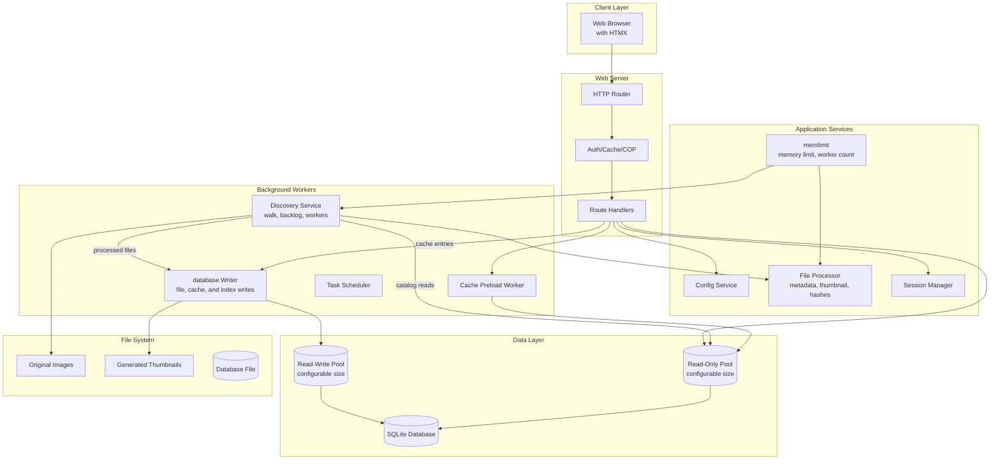

### 3.2 Request Flow

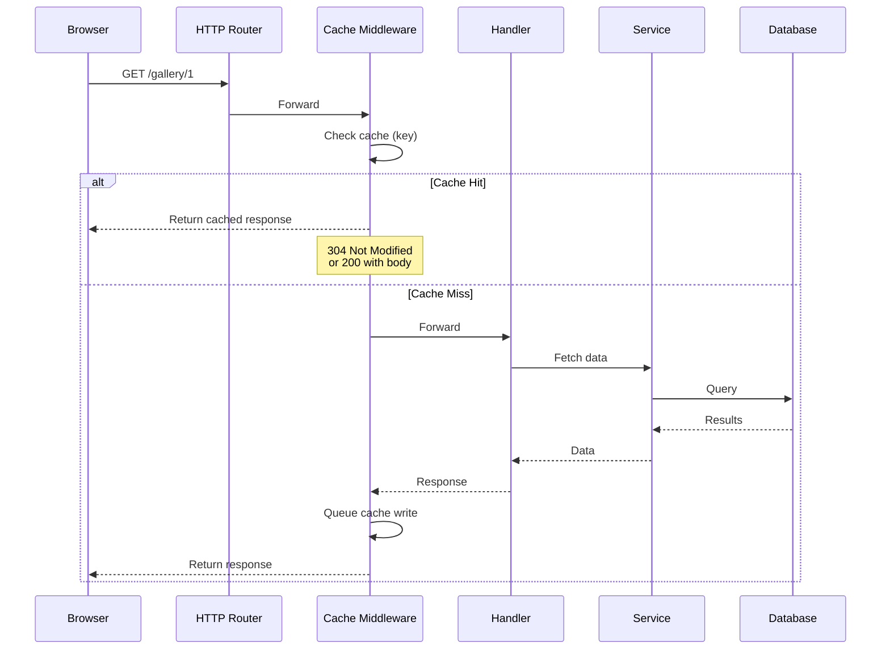

Authentication is applied route-specifically (e.g., `/config`, `/dashboard`, `/server/*`) inside the mux after routing.

---

## 4. Core Components

### 4.1 Application Structure

The application is organized into domain-driven packages under `internal/`:

| Package                 | Purpose                                                                                                                                                                   | Key Exports                                                                                                                                                                                                                                                                                      |
| ----------------------- | ------------------------------------------------------------------------------------------------------------------------------------------------------------------------- | ------------------------------------------------------------------------------------------------------------------------------------------------------------------------------------------------------------------------------------------------------------------------------------------------ |
| **server**              | HTTP server, routing, orchestration                                                                                                                                       | `App`, `getRouter`, middleware                                                                                                                                                                                                                                                                   |
| **server** (managers)   | Orchestration structs on `App` (infra embedded; others pointer fields)                                                                                                    | `InfrastructureService`, `RuntimeManager`, `HandlerManager`, `SubsystemManager`                                                                                                                                                                                                                  |
| **server** (test seams) | Optional test doubles (production pkg)                                                                                                                                    | `testseams.go`: `AppTestSeams`, `*TestSeams` structs                                                                                                                                                                                                                                             |
| **server/auth**         | Authentication service                                                                                                                                                    | `AuthService`, `Authenticate`                                                                                                                                                                                                                                                                    |
| **server/cachebatch**   | Cache batch-load coordination                                                                                                                                             | batch loader helpers                                                                                                                                                                                                                                                                             |
| **server/cachepreload** | Cache preload manager & tasks                                                                                                                                             | `Manager`, preload tasks                                                                                                                                                                                                                                                                         |
| **server/config**       | Configuration management                                                                                                                                                  | `Config`, `ConfigService`                                                                                                                                                                                                                                                                        |
| **server/database**     | Database setup, migrations, pools; the write path (`Writer`, batch flush, folder-index rebuild, WAL checkpoint and `PRAGMA optimize`) and the discovery directory catalog | `Setup`, `RecreatePoolsWithConfig`, `Writer`, `NewWriter`, `ErrFolderIndexRebuild`, `NewDiscoveryDirEntMapFunc`                                                                                                                                                                                  |
| **server/files**        | File processing: metadata, thumbnail, and hashes for one file                                                                                                             | `FileProcessor`, `NewFileProcessor`, `File`, `InvalidFile`, `InvalidReason`                                                                                                                                                                                                                      |
| **server/handlers**     | Route handlers                                                                                                                                                            | `GalleryHandlers`, `AuthHandlers`, `MenuHandlers`, `ThemeHandlers`, `ConfigHandlers`, `DashboardHandlers`, `ServerHandlers`, `HealthHandlers`                                                                                                                                                    |
| **server/interfaces**   | Dependency interfaces for handlers                                                                                                                                        | `ServerDeps`, `HandlerQueries`                                                                                                                                                                                                                                                                   |
| **server/logging**      | Request logging helpers                                                                                                                                                   | logging middleware wrappers                                                                                                                                                                                                                                                                      |
| **server/metrics**      | Runtime metrics collection                                                                                                                                                | `Collector`                                                                                                                                                                                                                                                                                      |
| **server/middleware**   | HTTP middleware (auth, conditional, logging, loopback, pprof access)                                                                                                      | `AuthMiddleware`, `ConditionalMiddleware`, `LoopbackOnly`, `PprofAccess`                                                                                                                                                                                                                         |
| **server/modulestate**  | Module active-state tracking                                                                                                                                              | `ModuleStateService`                                                                                                                                                                                                                                                                             |
| **server/pathutil**     | Image-directory path utilities                                                                                                                                            | `SafeImagePath`, `RemoveImagesDirPrefix`                                                                                                                                                                                                                                                         |
| **server/conditional**  | Pure ETag/304 helper package                                                                                                                                              | conditional request helpers                                                                                                                                                                                                                                                                      |
| **server/security**     | Lockout calculations                                                                                                                                                      | `CalculateLockout`, `IsLocked`                                                                                                                                                                                                                                                                   |
| **server/session**      | Session management only                                                                                                                                                   | `SessionManager`, `Manager`                                                                                                                                                                                                                                                                      |
| **server/template**     | Shared template data helpers                                                                                                                                              | `AddCommonData`                                                                                                                                                                                                                                                                                  |
| **server/ui**           | Template rendering helpers                                                                                                                                                | `RenderTemplate`                                                                                                                                                                                                                                                                                 |
| **server/validation**   | Config validation helpers                                                                                                                                                 | validators                                                                                                                                                                                                                                                                                       |
| **cachelite**           | HTTP response caching                                                                                                                                                     | `HTTPCacheMiddleware`, `EvictLRU`                                                                                                                                                                                                                                                                |
| **tableswap**           | Atomic SQLite table rotation                                                                                                                                              | `CloneEmpty`, `CreateIndexes`, `Swap`                                                                                                                                                                                                                                                            |
| **rssmonitor**          | Optional Linux process RSS monitor                                                                                                                                        | `Run`                                                                                                                                                                                                                                                                                            |
| **sqlite3stat**         | SQLite connection memory-status helpers                                                                                                                                   | `DBStatusMem`, `PutDebugAttrs`                                                                                                                                                                                                                                                                   |
| **workerpool**          | Concurrent task processing                                                                                                                                                | `Pool`, `Worker`                                                                                                                                                                                                                                                                                 |
| **scheduler**           | Cron-like task scheduling                                                                                                                                                 | `Scheduler`, `Task` interface                                                                                                                                                                                                                                                                    |
| **queue**               | Thread-safe deque                                                                                                                                                         | `Queue`                                                                                                                                                                                                                                                                                          |
| **writebatcher**        | Generic batching worker with disk overflow; `database.Writer` is its user                                                                                                 | `WriteBatcher`, `Config`                                                                                                                                                                                                                                                                         |
| **dque**                | Persistent on-disk FIFO queue (Writer overflow + discovery backlog)                                                                                                       | `New`, `Queue`                                                                                                                                                                                                                                                                                   |
| **flock**               | Cross-platform file locking                                                                                                                                               | `Flock`                                                                                                                                                                                                                                                                                          |
| **errors**              | Error sentinels for dque                                                                                                                                                  | `ErrXxx` sentinels                                                                                                                                                                                                                                                                               |
| **dbconnpool**          | SQLite connection pools                                                                                                                                                   | `DbSQLConnPool`                                                                                                                                                                                                                                                                                  |
| **testdb**              | Memory-backed main/thumbs test databases (`MemoryDatabases`, caller-supplied schema key, process-local seeds)                                                             | `NewMemoryDatabases`, `MainURI`, `ThumbsURI`, `Close`                                                                                                                                                                                                                                            |
| **gallerydb**           | Database queries (sqlc)                                                                                                                                                   | `Queries`, `CustomQueries`                                                                                                                                                                                                                                                                       |
| **gallerylib**          | File import / path-chain upserts                                                                                                                                          | `Importer`                                                                                                                                                                                                                                                                                       |
| **thumbnail**           | Thumbnail and pHash from decoded pixels, MD5 of the source bytes; shared memory budgets                                                                                   | `Pool`, `Generator`, `GenerateThumbnailAndHashes`                                                                                                                                                                                                                                                |
| **metadata**            | EXIF, IPTC, and XMP through a pool of ExifTool servers                                                                                                                    | `Extractor`, `Info`                                                                                                                                                                                                                                                                              |
| **memlimit**            | Go soft memory limit from RAM and need; sizes the worker count                                                                                                            | `Apply`, `Need`, `Limit`                                                                                                                                                                                                                                                                         |
| **discovery**           | Finds new and changed images and imports them: walk, disk backlog, workers, run counters                                                                                  | `Service`, `Config`, `Deps`, `Stats`, `Writer`                                                                                                                                                                                                                                                   |
| **multihandler**        | Multi-handler structured logging                                                                                                                                          | `MultiHandler`                                                                                                                                                                                                                                                                                   |
| **profiler**            | Optional CPU/mem/block profiling                                                                                                                                          | `Start`                                                                                                                                                                                                                                                                                          |
| **coords**              | Geographic coordinate parsing                                                                                                                                             | `Parse`                                                                                                                                                                                                                                                                                          |
| **humanize**            | Human-readable formatting                                                                                                                                                 | formatters                                                                                                                                                                                                                                                                                       |
| **log**                 | Structured logging                                                                                                                                                        | `Logger`                                                                                                                                                                                                                                                                                         |
| **gensyncpool**         | Reset-enforcing `sync.Pool` wrappers                                                                                                                                      | `NewPool`                                                                                                                                                                                                                                                                                        |
| **osza**                | Zero-allocation `os` helpers (facade); subpackages hold syscall implementations                                                                                           | `ReadDir`, `Entry` (`IsDir`, `Type`, `Info`), `ErrOverflow`; stat: `FileMeta`, `LstatAt`, `StatAt`, `LstatJoin`, `StatJoin`, `ErrPathBuffer`, `ErrNilFileMeta` — import `internal/osza` only ([README](../internal/osza/README.md); stat sign-off: [osza-stat-signoff.md](osza-stat-signoff.md)) |
| **getopt**              | Config from flags/env                                                                                                                                                     | config loader                                                                                                                                                                                                                                                                                    |
| **parallelwalkdir**     | Bounded `GOMAXPROCS` workers; unbounded schedule queue + feeder → `dirCh`; emits `ReportedFile` (path, mtime, size)                                                       | `ParallelWalk`, `NewWalker`, `Option`, `WalkDirFunc`, `WithDirChCapacity`, `ReportedFile`, `WithMaxReportedFiles` (bench/tests only)                                                                                                                                                             |
| **testutil**            | Shared test helpers                                                                                                                                                       | `Equals`, `HTMLContains`                                                                                                                                                                                                                                                                         |
| **gen-test-files**      | Synthetic test file generation                                                                                                                                            | `Generate`                                                                                                                                                                                                                                                                                       |

### 4.2 Component Diagram

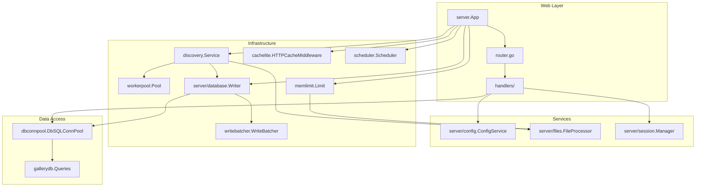

---

## 5. Data Layer

**Packages:** [Process-to-package map § Database, batching, and schema](#23-database-batching-and-schema) (`database` including the Writer, `writebatcher`, `dque`, `gallerydb`, `dbconnpool`, `tableswap`, `server` pool wiring).

### 5.1 Database writer

`database.Writer` ([`internal/server/database/writer.go`](../internal/server/database/writer.go)) is the one component that writes high-volume data to the main database. The process starts a single Writer after the pools are configured (`InfrastructureService.StartWriteBatcher`), so these writes share one write lease; other operations, such as config saves, write through their own RW connections. It sends four kinds of write through one `writebatcher.WriteBatcher`:

- **Files:** a processed file with its path chain, metadata (EXIF, IPTC, XMP), thumbnail, and folder tile.
- **Invalid files:** a file the processor could not import, recorded in `invalid_files`.
- **HTTP cache entries:** responses queued by the cache middleware.
- **Folder-index rows:** rows of the `file_folder_index` rebuild.

**Batching:**

- Each batch is one transaction on a connection leased from the read-write (RW) pool. A batch is flushed when it reaches 10,000 writes or 8 MiB, checked after each write is added, and normally when its 50 ms timer fires (a `dque` drain in progress can delay the timer).
- Within a batch, `flush.write` writes files, then invalid files, then gallery cache entries, then other cache entries, then folder-index rows.
- Thumbnail buffers and cache entries return to their pools only after the batch commits (`release` in `batch.go`), so a failed batch can be written again.
- `Close` stops new submits (`writebatcher.ErrClosed`) and then attempts a final flush of the writes held in memory; if that flush fails, its batch cannot be requeued and is lost. A cache entry that cannot be queued returns to its pool.

**Overflow queue (`dque`):**

When the batcher's in-memory channel is full, `Submit` writes the item to `dque`, a segment-backed on-disk first-in, first-out (FIFO) queue in `<db>-dque/` beside the SQLite database, instead of dropping it. The quota is the config key `dque_max_disk_bytes` (default 50 GiB; `0` is unlimited); at the quota, `Submit` returns `writebatcher.ErrQuotaExceeded` and the write is not queued. The quota is set at start and on config changes through `Writer.SetMaxDiskBytes`. The worker drains `dque` in batches between channel items, so new submissions are not starved. `dque` holds a `flock` on its directory.

- `Close` does not drain `dque`: records still queued on disk are replayed after the next start, subject to the replay checks: folder-index rows are dropped outside an active rebuild or from an earlier rebuild generation, and an invalid-file record is skipped when the file has since been imported with the same mtime and size. The worker takes items off `dque` before their batch commits, so a crash can lose the items of the batch in progress.
- `App.Run` starts the Writer with the drain deferred. The drain is enabled when `Serve` starts the HTTP server goroutine (`onServerListening` calls `StartDQueDrain`), without waiting for the bind to succeed.
- `database.Setup` deletes `<db>-dque/` when the database is migrated across the pHash migration (25), because queued writes would carry hashes from the old algorithm.

`gob` encodes queued writes: `batchedWrite` and `files.File` implement `GobEncode`/`GobDecode` (the `*bytes.Buffer` thumbnail travels as raw bytes), and an `init()` in `batch.go` registers `int64` and `sql.Null*` types stored inside sqlc-generated `interface{}` fields.

**`internal/queue` vs `internal/dque`:** These are unrelated. `internal/queue` is a generic in-memory deque (goroutine-safe, resizable ring buffer) used by tests and helpers. `internal/dque` is a segment-backed on-disk FIFO with two uses:

- The Writer keeps an on-disk queue (`<db>-dque/`) for overflow. Records still on disk at shutdown are replayed after the next start, with the replay checks and the pHash-migration deletion described above.
- Discovery keeps a **disposable** backlog (`discovery-dque/` in the database directory, beside `sfpg.db`) that the walk fills and the file workers drain. Items are `discovery.PathWork` (path plus mtime and size from the walk), encoded in [`internal/discovery/backlog.go`](../internal/discovery/backlog.go). `discovery.New` deletes the directory and opens a new queue, so a full re-walk is the recovery after an interrupted run.

**Write-path details:**

- **Prepared-statement threading:** `flush.begin` leases an RW connection and `flush.write` calls `WithTx(tx)` on that connection's prepared `*gallerydb.CustomQueries`, so the file and invalid-file statements reuse their compiled plans. Cache writes run through `gallerydb.New(tx)`, and folder-index inserts prepare their statement on the transaction. `flush.succeeded` and `flush.failed` return the connection to the pool.
- **Intra-batch memoization:** One `gallerylib.Importer` is made per batch and reused for all its files. Its `folderCache` (path to folder ID) avoids repeated `GetFolderByPath` queries in `UpsertPathChain`, and `tiledDirs` skips repeated folder-tile queries for files in the same directory.
- **Metadata replacement:** `writeMetadata` replaces a file's stored EXIF, IPTC, and XMP rows, so a value removed from the file is removed from the database.
- **Thumbnail check:** `writeFile` queries `thumbnail_exists_view` only for a file row that already existed; a new row cannot have a thumbnail yet. An existing thumbnail is kept.
- **Invalid-file replay:** `writeInvalidFile` skips a record when a file with the same path, mtime, and size was imported since, which happens when an older record replays from `dque`.

**Folder-index rebuild:** `Writer.RebuildFolderIndex` rebuilds `file_folder_index` in a new table and swaps it in (see [Database Schema](#54-database-schema)). It reads `files` on the read-only (RO) pool in chunks: a chunk ends at the first folder boundary after 2^18 `(file_id, folder_id)` pairs, so no folder is split, or at the end of the rows. The RO connection is returned before the chunk's rows are submitted to the batcher, and the RW connection is held only to clone the table and to swap, so the batcher keeps writing.

- A generation (from the clock) ties rows to one rebuild. Rows of another generation, from an earlier process or rebuild, are skipped.
- Folder-index batches are dropped before `BeginTx` while no rebuild is active, and rows are skipped when `file_folder_index_new` does not exist.
- The rebuild waits until every submitted row is committed, and fails when that count has not changed for 30 s.
- `InsertFileFolderIndexNewRows` prepares its INSERT on the batch transaction, because `file_folder_index_new` is created at runtime by `tableswap.CloneEmpty` and does not exist at pool preparation. The SQL lives in `sqlc/queries/file_folder_index_rebuild.sql`, which is embedded and not part of `sqlc generate`.
- Every failure except cancellation wraps `database.ErrFolderIndexRebuild`. Shutdown cancels a rebuild and returns the bare context error.

**Maintenance** (`maintenance.go`) runs after each commit and every 5 minutes, with no transaction open:

- A `wal_checkpoint(TRUNCATE)` when the WAL exceeds 256 MiB, checked after each commit and on the batcher's maintenance timer; and, on the maintenance timer, when 5 minutes have passed since the previous maintenance run (checkpoint or not). Both are skipped while the rebuild's RO cursor is open. The post-commit check is also skipped after a batch with no folder-index rows and no file, invalid-file, or cache entry.
- `PRAGMA optimize` when the optimize interval has passed (default 1 hour; `Writer.SetOptimizeInterval`).

**Implementation files:**

- [`internal/server/database/writer.go`](../internal/server/database/writer.go): `Writer`, `NewWriter`, submit methods, `Close`.
- [`internal/server/database/batch.go`](../internal/server/database/batch.go): `batchedWrite` union, gob encoding, `release`.
- [`internal/server/database/flush.go`](../internal/server/database/flush.go): transaction callbacks and per-write SQL.
- [`internal/server/database/folder_index.go`](../internal/server/database/folder_index.go): rebuild and its generation state.
- [`internal/server/database/maintenance.go`](../internal/server/database/maintenance.go): WAL checkpoint and `PRAGMA optimize`.
- [`internal/server/infrastructure_pool.go`](../internal/server/infrastructure_pool.go): starts the Writer and reconfigures pools.
- [`internal/server/files/gob.go`](../internal/server/files/gob.go): `GobEncode`/`GobDecode` for `files.File`.
- [`internal/gallerylib/importer.go`](../internal/gallerylib/importer.go): file import with `folderCache` and `tiledDirs`.

### 5.2 Database Architecture

SFPG uses SQLite with separate read-only and read-write connection pools, plus a separate `thumbs.db` for thumbnail blobs, to maximize concurrency and keep large binary data out of the main database:

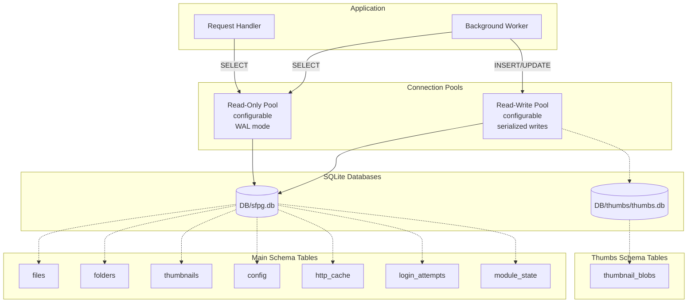

- **Main database:** `DB/sfpg.db` holds folders, files, metadata, config, HTTP cache, and module state.
- **Thumbnails database:** `DB/thumbs/thumbs.db` holds only `thumbnail_blobs(thumbnail_id, data)` so large JPEG blobs don't bloat the main database or its write-ahead log (WAL).

### 5.3 Connection Pool Design

**Why separate pools?**

- SQLite allows concurrent reads but writes are serialized
- Write-ahead logging (WAL) mode enables one writer + multiple readers
- Separate pools prevent writer starvation
- Read-heavy workloads don't block writes

**Pool Configuration:**

Both pools share the same configurable size, controlled by the database configuration keys `db_max_pool_size` (default `100`) and `db_min_idle_connections` (default `1`), with a pool monitor interval `db_pool_monitor_interval` (default `1m`). Startup sizes the pools from the loaded config through `reconfigurePoolsFromConfig()`.

Pools are reconfigured only before the Writer starts. `InfrastructureService.ReconfigurePools` returns an error once the Writer has started, because the Writer keeps the pools it was started with. A saved change to a pool setting therefore takes effect after an explicit restart (these three keys are marked as requiring a restart).

The live pools always get a positive monitor interval: creating pools with a nil `Config` (e.g. the early `setDB()` bootstrap before config load) or with `db_pool_monitor_interval <= 0` falls back to the `1m` default — a `0` interval never disables the idle grow/shrink monitor.

```go
Read-Only Pool:  MaxConnections = db_max_pool_size  (mode=ro, WAL mode persisted by RW pool)
Read-Write Pool: MaxConnections = db_max_pool_size  (journal_mode=WAL, _txlock=immediate)
```

### 5.4 Database Schema

| Table               | Purpose                  | Key Fields                                                                                                                                                                             |
| ------------------- | ------------------------ | -------------------------------------------------------------------------------------------------------------------------------------------------------------------------------------- |
| **file_paths**      | Normalized file paths    | `id`, `path` (unique)                                                                                                                                                                  |
| **folder_paths**    | Normalized folder paths  | `id`, `path` (unique)                                                                                                                                                                  |
| **files**           | Image metadata           | `id`, `folder_id`, `path_id`, `filename`, `size_bytes`, `mtime`, `md5`, `phash`, `mime_type`, `width`, `height`                                                                        |
| **folders**         | Directory structure      | `id`, `parent_id`, `path_id`, `name`, `mtime`, `tile_id`                                                                                                                               |
| **thumbnails**      | Generated thumbnail refs | `id`, `file_id`, `size_label`, `width`, `height`, `format`                                                                                                                             |
| **thumbnail_blobs** | Thumbnail JPEG bytes     | `thumbnail_id`, `data` (in `thumbs.db`)                                                                                                                                                |
| **exif_metadata**   | EXIF camera/location     | `file_id`, `camera_make/model`, `focal_length`, `aperture`, `iso`, `capture_date`, etc.                                                                                                |
| **iptc_metadata**   | IPTC fields              | `file_id`, `title`, `description`, `keywords`, etc.                                                                                                                                    |
| **iptc_keywords**   | IPTC keyword rows        | `id`, `file_id`, `keyword`                                                                                                                                                             |
| **xmp_properties**  | XMP property rows        | `id`, `file_id`, `namespace`, `property`, `value`                                                                                                                                      |
| **xmp_raw**         | Raw XMP packet           | `file_id`, `raw_xml`                                                                                                                                                                   |
| **config**          | Key-value configuration  | `key`, `value`, `type`, `category`, `requires_restart`, `description`, `default_value`, etc.                                                                                           |
| **http_cache**      | HTTP response cache      | `key`, `method`, `path`, `query_string`, `status`, `content_type`, `cache_control`, `etag`, `last_modified`, `vary`, `body`, `content_length`, `created_at`, `expires_at`              |
| **login_attempts**  | Failed login tracking    | `username` (PK), `failed_attempts`, `locked_until`, `last_attempt_at`                                                                                                                  |
| **invalid_files**   | Unprocessable files      | `path` (PK), `folder_id` (NOT NULL, FK `folders(id)` ON DELETE CASCADE, migration **022**), `mtime`, `size`, `reason`, `created_at`, `updated_at`; index `idx_invalid_files_folder_id` |
| **module_state**    | Module active state      | `name` (PK), `is_active`, `last_started_at`, `last_finished_at`, `payload` (TEXT JSON)                                                                                                 |

**Views:** `folder_view`, `file_view`, `thumbnail_exists_view`, `folder_tile_exists_view` (plus quality-control views `qc_file_path_subset_file_name` and `qc_folder_path_subset_file_path`).

**file_folder_index rebuild:** `Writer.RebuildFolderIndex` ([`folder_index.go`](../internal/server/database/folder_index.go)) leases an RW connection, creates an empty `file_folder_index_new` with `tableswap.CloneEmpty`, starts a new generation, and returns the connection. It then reads `(file_id, folder_id)` pairs from `files` on the RO pool (`ORDER BY folder_id, filename, id`) in chunks that end at the first folder boundary after 2^18 pairs, or at the end of the rows. For each chunk the RO cursor is closed and its connection returned before the rows are computed in Go per folder and submitted to the Writer's batcher, which inserts them into `file_folder_index_new`. Rows of another generation are skipped, and folder-index-only batches are dropped while no rebuild is active (see [§5.1](#51-database-writer)). When every submitted row has committed, the rebuild takes an RW connection again, runs `CreateIndexes`, then `Swap`. `CreateIndexes` sets `PRAGMA temp_store=FILE` on the leased RW connection before `CREATE INDEX`, then restores the previous `temp_store` (the connection data source name (DSN) stays `memory` for other work). `Swap` `DROP TABLE`s `{active}_to_be_dropped` before it returns (prior leftover stale is dropped inside the cutover transaction before the renames). Explicit index names after the first copy are `idx_*_1` until a later rotate reuses the base name once stale is gone.

### 5.5 Query Generation (sqlc)

All generated queries are produced by [sqlc](https://sqlc.dev/) from the explicit 14-file `queries:` list in `sqlc.yaml` (nested under `sql:` / `schema`), currently: `sqlc/queries/files.sql`, `folders.sql`, `http_cache.sql`, `config.sql`, `module_state.sql`, `thumbnails.sql`, `xmp.sql`, `login_attempts.sql`, `preload_routes.sql`, `file_paths.sql`, `folder_paths.sql`, `iptc.sql`, `exif.sql`, `invalid_files.sql`. Each compiles to a `gallerydb/*.sql.go` file; the directory listing snapshot below is illustrative, not the source of truth (the authoritative list is the yaml):

```
sqlc/queries/
├── files.sql          → gallerydb/files.sql.go
├── folders.sql        → gallerydb/folders.sql.go
├── http_cache.sql     → gallerydb/http_cache.sql.go
├── config.sql         → gallerydb/config.sql.go
└── ...
```

**Embed-only, not generated:** `sqlc/queries/file_folder_index_rebuild.sql` (folder-index rebuild SELECT + dest INSERT) is intentionally omitted from the `sqlc.yaml` generate list and loaded via `go:embed` (package `sqlcqueries`) into `gallerydb` (see [§5.1](#51-database-writer)). It is split on `-- statement-break` into `parts[0]` (SELECT) and `parts[1]` (INSERT). Its dest table is created at runtime by `CloneEmpty`, so a generated pool-prepared INSERT would fail at pool init.

**Benefits:**

- Type-safe queries
- Compile-time SQL validation
- No SQL injection risk
- Easy to refactor

**Testing policy (gallerydb):**

- sqlc-generated output (`db.go`, `querier.go`, sqlc `*.sql.go` — **not** hand-written `custom.sql.go`) — never add test seams; run `sqlc generate` without post-processing.
- Hand-written `custom.sql.go` + `custom_seams.go` — package-level hooks for custom query error-path tests only.
- Generated queries: happy-path tests in untagged `gallerydb_db_test.go` and other `gallerydb_*_test.go` files.
- Custom queries: `gallerydb_seams_test.go` (prepare/close/row fault injection).
- Shared/isolated SQL test DBs (`testdb_harness.go`): open memory-backed test databases through `testdb.NewMemoryDatabases` with `migrations.LatestSchemaKey` and use its `MainURI`/`ThumbsURI` URIs. `gallerydb` owns one shared lease plus one fresh lease per isolated test; `gallerylib` uses the `gallerydb` helper and does not import `internal/testdb` directly.

---

## 6. Web Server Layer

**Packages:** [Process-to-package map § Web request path](#21-web-request-path); lifecycle and discovery entry points in `server` (`app_lifecycle.go`, `app_startup.go`, `runtime_manager.go`).

### 6.1 App Orchestration

`App` (`internal/server/app.go`) is the **root orchestrator and change nexus** for the process: one value owns config, sessions, DB pools, HTTP serving, background subsystems, and handler wiring.

**Managers are organizational boundaries, not isolated services.** They group code and lifecycle hooks; everything still runs in-process on the same `App` instance.

| Component               | Wiring on `App`                         | Role                                                                                                                                                       |
| ----------------------- | --------------------------------------- | ---------------------------------------------------------------------------------------------------------------------------------------------------------- |
| `InfrastructureService` | **Embedded** (`*InfrastructureService`) | DB pools, write batcher, HTTP cache middleware, WAL checkpoints, cache eviction — methods promote onto `App` (e.g. `app.dbRwPool`, `app.submitCacheWrite`) |
| `RuntimeManager`        | Pointer field                           | Process lifecycle, HTTP `Serve`, restart/exec, gallery stats cache                                                                                         |
| `HandlerManager`        | Pointer field                           | Constructs and holds domain handler groups                                                                                                                 |
| `SubsystemManager`      | Pointer field                           | Background subsystems (discovery, cache batch load, worker pool wiring)                                                                                    |

Embedding `InfrastructureService` is intentional convenience (handlers and `App` methods share pools and batcher directly) but it **undoes encapsulation**: infra fields and methods are reachable through `*App` without going through the manager type.

**Handler dependencies vs `App`:** `HandlerManager.Build` takes `interfaces.ServerDeps`, not `*App`. Production passes `app` (`var _ interfaces.ServerDeps = (*App)(nil)` in `server.go`). That interface is a **compile-time narrow surface** — not a separate object. `ServerDeps` composes `CredentialStore`, `ConfigOps`, `GalleryOps`, and `ServerControl`; handler groups that need less accept those sub-interfaces directly (e.g. `ConfigHandlers` takes `CredentialStore` + `ConfigOps` only). Unit tests use fakes of those interfaces; integration tests usually build a full `App`.

**Practical implication:** New features often touch `App` methods, promoted infra fields, manager `testSeams`, and one or more handler groups. Decomposing `App` further (compose infra without embed, thinner `ServerDeps` adapter) is structural refactor territory, not required for correctness today.

### 6.2 Test Seams

Production code uses optional test doubles in `internal/server/testseams.go`. Each orchestration struct holds an unexported `testSeams` field.

**Semantics:**

- **Nil func seam:** zero value → production path (`if seam != nil` in caller).
- **Infrastructure cache func seams:** `NewInfrastructureService` seeds `GetCacheSizeBytes`, `GetCacheEntryCount`, and `EvictLRU` with `cachelite` production functions. Call sites invoke these fields directly (no nil-check); tests override the fields on the struct.
- **Pre-`New()` injection:** set package-level `defaultNewTestSeams` before `New()`; `New()` copies it into `app.testSeams`. The committed variable must stay the **zero value**; prefer `app.testSeams.*` after `New()` when possible.
- **Discovery and the write path:** no seam replaces a discovery run, the folder-index rebuild, or the Writer. Tests run real discovery on a small images directory (see `trigger_discovery_integration_test.go`).

**Field inventory** (keep in sync with `testseams.go` when adding seams):

| Struct                      | Field                        | Replaces / use                                                                                |
| --------------------------- | ---------------------------- | --------------------------------------------------------------------------------------------- |
| **AppTestSeams**            | `NewParseTemplates`          | `ui.ParseTemplates` in `New()`                                                                |
|                             | `NewExit`                    | `os.Exit` on template parse failure                                                           |
|                             | `Serve`                      | `App.Serve` / `RuntimeManager.Serve`                                                          |
|                             | `ProfilerStart`              | `profiler.Start` in `Run()`                                                                   |
|                             | `MemoryReclaimer`            | memory reclaimer goroutine in `Run()`                                                         |
|                             | `ModuleStateActive`          | `moduleStateService.IsActive` in cache batch load                                             |
|                             | `BatchLoadManagerRun`        | `batchLoadManager.Run`                                                                        |
|                             | `GalleryStatsStartup`        | async gallery stats goroutine at startup                                                      |
|                             | `OnTriggerRestart`           | runs after a restart is requested through `App.TriggerRestart`                                |
|                             | `FallbackConfig`             | config when `loadConfig` fails in `Run()`                                                     |
|                             | `ConfigService`              | `config.NewService` in `setDB` / reconfigure                                                  |
|                             | `LoadConfig`                 | `config.Load` in `loadConfig`                                                                 |
|                             | `Executable`                 | `os.Executable` in `setRootDir`                                                               |
|                             | `SetupBootstrapLogging`      | `logging.SetupBootstrap`                                                                      |
|                             | `DatabaseSetup`              | `database.Setup` in CLI unlock / ETag paths                                                   |
| **InfrastructureTestSeams** | `GetCacheSizeBytes`          | cache size calibration (default: `cachelite.GetCacheSizeBytes`)                               |
|                             | `GetCacheEntryCount`         | cache entry count (default: `cachelite.CountCacheEntries`)                                    |
|                             | `EvictLRU`                   | cache eviction (default: `cachelite.EvictLRU`)                                                |
|                             | `PragmaOptimize`             | `PRAGMA optimize` path                                                                        |
|                             | `HandlerQueries`             | live `HandlerQueries` from pool connection                                                    |
|                             | `RecreatePoolsWithConfig`    | pool recreate in `ReconfigurePools`                                                           |
|                             | `PragmaOptimizePollInterval` | test tuning (non-zero overrides poll interval)                                                |
|                             | `PragmaOptimizeMaxWait`      | test tuning (non-zero overrides max wait)                                                     |
|                             | `BeforeCloseDatabasePools`   | hook on the `App.Shutdown` goroutine immediately before the database pools close (tests only) |
| **RuntimeManagerTestSeams** | `Executable`                 | `os.Executable` for restart                                                                   |
|                             | `ExecCommand`                | `exec` for restart                                                                            |
|                             | `Exit`                       | `os.Exit` for restart failure                                                                 |
|                             | `BeforeListen`               | hook immediately before `ListenAndServe`                                                      |
|                             | `Shutdown`                   | HTTP server shutdown                                                                          |
| **HandlerManagerTestSeams** | `BuildHandlers`              | `HandlerManager.buildHandlers`                                                                |

**Discouraged patterns** (do not add new instances; migrate legacy when touching the area):

- **Package-level func swaps** in production `.go` files (e.g. `var somethingFn = …` mutated from tests). They are not parallel-safe, easy to leak across tests, and are absent from this inventory. Prefer unexported `testSeams` on the type under test. Legacy examples outside `internal/server` include `gallerydb/custom_seams.go`, `migrations/migrations.go`, `internal/profiler/profiler.go`, and `internal/server/database/app.go`. In **`internal/server/cachepreload`**, **`PreloadManager`** and **`FolderPreloadTask`** use instance **`testSeams`** (see below).
- **Unexported handler func hooks** when `interfaces.ServerDeps`, `ConfigOps`, or `GalleryOps` already expose the dependency. Do not add new ones. **`ConfigHandlers`** uses wired **`GalleryOps.GetConfigQueries`** (same as `cpc.Queries` on `*App`); the old `getConfigQueries` struct field was removed.
- **`defaultNewTestSeams`:** must remain zero in committed code. If a test sets it before `New()`, use `t.Cleanup(func() { defaultNewTestSeams = AppTestSeams{} })`. Set seams that `New()` does not read on `app.testSeams` after `New()`.

**`cachepreload` seams:** **`PreloadManager`** holds unexported **`testSeams`** (`SchedulerAddTask` / `SchedulerRemoveTask`; nil → real scheduler methods). **`FolderPreloadTask`** holds unexported **`testSeams`** (`PoolGet` / `PoolPut` / `GetPreloadRoutes` / `CacheExists` / `SchedulerAddTask`; nil → production methods).

Typical test assignments: `app.testSeams.Serve`, `app.testSeams.LoadConfig`, `app.testSeams.GalleryStatsStartup`, `app.InfrastructureService.testSeams.HandlerQueries`, `app.RuntimeManager.testSeams.BeforeListen`, `app.HandlerManager.testSeams.BuildHandlers`.

Do **not** add `testHook*` fields to production structs or use promoted `app.testHook*` assignments in tests (embedding made those ambiguous; they were removed in favor of explicit `*.testSeams.*` paths).

### 6.3 Server Lifecycle

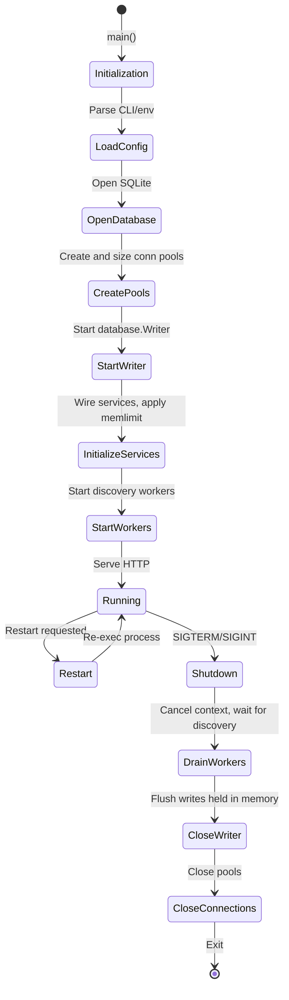

**Startup discovery:** When `run_file_discovery` is true and the process was not started by a config or server restart, `App.Run` starts `App.runStartupDiscovery` ([`app_startup.go`](../internal/server/app_startup.go)) on the runtime wait group (`RuntimeManager.wg`), which `Shutdown` waits for. The goroutine calls `TriggerDiscovery` and then:

- **Folder-index rebuild failed** (`errors.Is(err, database.ErrFolderIndexRebuild)`): it logs the failure, sends the error to `Run`, and cancels the app context. `Serve` returns, `Run` returns the error, and the process exits with status 1 after `main` calls `Shutdown`. The goroutine never calls `Shutdown` itself.
- **Another error, or the app is stopping:** it returns without further action.
- **Success:** it schedules `PRAGMA optimize` and, when `restart_after_discovery` is true (the default), requests a process restart. See [§7.1](#71-worker-pool-architecture).

`App.Shutdown` runs in this order: cancel the app context, wait for the runtime goroutines, the discovery workers, and any run in progress, shut down the preload manager, the file processor, the metadata extractor that `Start` created, and the discovery backlog, close the Writer, run `PRAGMA optimize`, then close the pools ([`app_lifecycle.go`](../internal/server/app_lifecycle.go)).

### 6.4 Request Middleware Stack

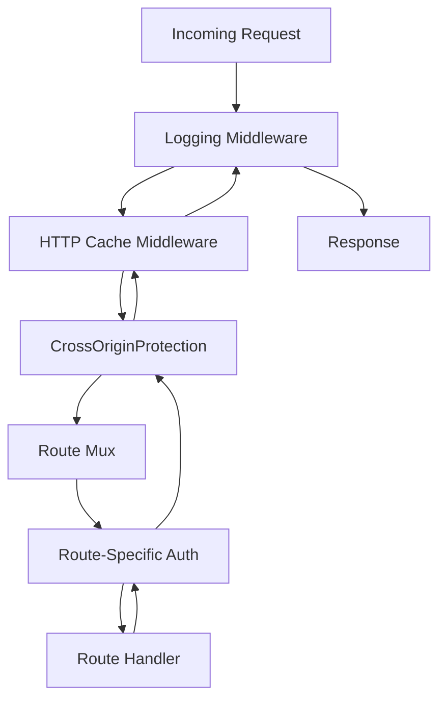

**Middleware Order (Critical):**

1. **Logging** (outermost) - Log all requests first
2. **HTTP Cache** - Check SQLite-backed response cache; return 304/hit if present
3. **CrossOriginProtection** - Same-origin check for unsafe methods via `Sec-Fetch-Site`/`Origin`/`Host`; no session tokens
4. **Mux** - Route matching
5. **Authentication** - Applied selectively to protected routes (not global)
6. **Handler** - Process request

There is no separate global Cross-Origin Resource Sharing (CORS) middleware.

### 6.5 Route Organization

Routes are registered in `internal/server/router.go` and organized into handler groups by domain:

| Handler Group         | Routes                                                                                                                                                                                                                                                     | Purpose                                                                       |
| --------------------- | ---------------------------------------------------------------------------------------------------------------------------------------------------------------------------------------------------------------------------------------------------------- | ----------------------------------------------------------------------------- |
| **AuthHandlers**      | POST /login, GET /login-form, GET /logout-form, POST /logout                                                                                                                                                                                               | Authentication                                                                |
| **ConfigHandlers**    | GET /config, POST /config, POST /config/themes, POST /config/increment-etag, POST /config/export/to-file, POST /config/import/preview, POST /config/import/commit, POST /config/restore-last-known-good, POST /config/restart, GET /config/export/download | Configuration                                                                 |
| **DashboardHandlers** | GET /dashboard                                                                                                                                                                                                                                             | Admin dashboard                                                               |
| **GalleryHandlers**   | GET /gallery/{id}, GET /image/{id}, GET /raw-image/{id}, GET /thumbnail/file/{id}, GET /thumbnail/folder/{id}, GET /lightbox/{id}, GET /info/folder/{id}, GET /info/image/{id}                                                                             | Browsing & viewing                                                            |
| **HealthHandlers**    | GET /, GET /health                                                                                                                                                                                                                                         | Health & root redirect                                                        |
| **MenuHandlers**      | GET /hamburger-menu, GET /about-modal                                                                                                                                                                                                                      | Session-aware menu and about modal                                            |
| **ServerHandlers**    | POST /server/shutdown, POST /server/discovery, POST /server/cache-batch-load, POST /server/restart, POST /dashboard/folder-index-error/ack                                                                                                                 | Server management                                                             |
| **ThemeHandlers**     | GET /theme/modal, POST /theme                                                                                                                                                                                                                              | Theme selection                                                               |
| **pprof**             | GET /debug/pprof/\*                                                                                                                                                                                                                                        | Profiling (direct loopback + authenticated; proxied or forward headers → 404) |

**Example:**

```go
// Gallery handlers (public, some cacheable)
mux.Handle("GET /gallery/{id}", withConditional(http.HandlerFunc(app.HandlerManager.galleryHandlers.GalleryByID)))
mux.Handle("GET /image/{id}", withConditional(http.HandlerFunc(app.HandlerManager.galleryHandlers.ImageByID)))
mux.Handle("GET /info/folder/{id}", withConditional(http.HandlerFunc(app.HandlerManager.galleryHandlers.InfoBoxFolder)))

// Config handlers (authenticated, not cacheable)
mux.Handle("GET /config", app.authMiddleware(cfgAuth(app.HandlerManager.configHandlers.ConfigGet)))
```

#### HTMX HTML responses

Handlers use two patterns: **layout partials** (shell vs inner content via `ui.RenderPage(..., partial)`) and **fragment-only** responses (`ui.RenderTemplate` with no layout). `AddCommonTemplateData` does **not** take a `partial` argument; the same template data keys apply to full pages and layout partials. Layout partial detection is **`ui.RenderPage` only** — see `internal/server/ui/htmx_partial.go`.

**Layout partial routes** (`ui.IsPartialRequest`, `ui.SetLayoutPartialVary`, `ui.SetPartialNoStore` on successful HTML paths after auth/validation; not on 401/error short-circuits):

| Route               | Handler                          | `partial == true` when                                                                   | `Vary` (success paths)    | `Cache-Control: no-store` on partial   |
| ------------------- | -------------------------------- | ---------------------------------------------------------------------------------------- | ------------------------- | -------------------------------------- |
| `GET /dashboard`    | `DashboardHandlers.DashboardGet` | `ui.PartialRuleHXRequestOnly` — `HX-Request: true` (case-sensitive); `HX-Target` ignored | `HX-Request`              | yes                                    |
| `GET /gallery/{id}` | `GalleryHandlers.GalleryByID`    | `ui.PartialRuleHXRequestTarget` with `ui.HXTargetGalleryContent` (`gallery-content`)     | `HX-Request`, `HX-Target` | yes (overwrites gallery cache headers) |

All other `RenderPage` call sites use `partial: false` (full layout only). Gallery full-page vs partial caching details: [§8.5 Client-Side Caching](#85-client-side-caching).

**Fragment-only HTMX** (always `ui.RenderTemplate`; **do not** use `IsPartialRequest`):

| Route                                           | Template(s)                                                                                                                                                                            |
| ----------------------------------------------- | -------------------------------------------------------------------------------------------------------------------------------------------------------------------------------------- |
| `GET /hamburger-menu`                           | `hamburger-menu-items.html.tmpl`                                                                                                                                                       |
| `GET /about-modal`                              | `about-modal.html.tmpl`                                                                                                                                                                |
| `GET /login-form`                               | `login-form-inner.html.tmpl` (via `LoginFormHandler` only)                                                                                                                             |
| `GET /logout-form`                              | `logout-form-inner.html.tmpl` (via `LogoutFormHandler` only)                                                                                                                           |
| `GET /config`                                   | `config-modal.html.tmpl`                                                                                                                                                               |
| `POST /config`                                  | `config-validation-error.html.tmpl`, `config-generic-error.html.tmpl`, `config-database-error.html.tmpl`, `config-save-restart-alert.html.tmpl`, `config-save-success-alert.html.tmpl` |
| `POST /config/increment-etag`                   | `config-etag-field.html.tmpl`, `config-generic-error.html.tmpl`                                                                                                                        |
| `POST /config/themes`                           | `config-save-success-alert.html.tmpl`                                                                                                                                                  |
| `POST /config/export/to-file`                   | `config-export-modal.html.tmpl`                                                                                                                                                        |
| `POST /config/import/preview`                   | `config-import-modal.html.tmpl`                                                                                                                                                        |
| `POST /config/import/commit`                    | `config-save-restart-alert.html.tmpl`, `config-import-success-alert.html.tmpl`                                                                                                         |
| `POST /config/restore-last-known-good`          | `config-restore-modal.html.tmpl`, `config-restore-success-alert.html.tmpl`                                                                                                             |
| `POST /config/restart`                          | `config-restart-initiated-alert.html.tmpl`                                                                                                                                             |
| `GET /theme/modal`                              | `theme-modal.html.tmpl`                                                                                                                                                                |
| `GET /lightbox/{id}`                            | `lightbox-content.html.tmpl`                                                                                                                                                           |
| `GET /info/folder/{id}`, `GET /info/image/{id}` | infobox templates                                                                                                                                                                      |

---

## 7. Background Processing

**Packages:** [Process-to-package map § Discovery and file processing](#22-discovery-and-file-processing) (`discovery`, `server`, `parallelwalkdir`, `files`, `metadata`, `thumbnail`, `memlimit`, `workerpool`, `dque`, `database`).

### 7.1 Worker Pool Architecture

End-to-end discovery and per-item processing (package subgraphs, code symbols, legend): [§7.2 File Processing Pipeline](#72-file-processing-pipeline). `discovery.New`, called from `SubsystemManager.Start`, opens the discovery disk backlog and wipes it on every start; `TriggerDiscovery` does not.

**Worker Pool Configuration:**

```go
Max Workers:  NumCPU - 2 (when NumCPU > 4); 2 (3-4 cores); 1 otherwise
              // overridable via config: WorkerPoolMax; 0 (default) keeps CPU auto
              // memlimit.Apply may then cut it to 1 when RAM cannot hold the
              // configured workers (GOMEMLIMIT set: unchanged)
Min Workers:  0 by default — no idle file workers
              // overridable via config: WorkerPoolMinIdle; 0 = no idle workers
              // (not auto-sizing). Workers are spawned only while the discovery
              // queue is non-empty and scale back to zero when it drains
Queue Size:   dedicated disk-backed dque — no in-memory bound
              // QueueSize no longer sizes the work queue; it still feeds the
              // dashboard queue-capacity display via SetQueueInfo
Idle Timeout: 10 seconds
              // overridable via config: WorkerPoolMaxIdleTime
```

**Worker pool lifecycle:** File workers exist only to drain the discovery
backlog — with min idle 0 the pool runs zero workers when the queue is empty
and scales up on backlog. A config restart (`POST /config/restart`) or server
restart (`POST /server/restart`) does **not** start a gallery walk: both go
through the shared `ExecRestart`, which injects `SEPG_SKIP_STARTUP_DISCOVERY=1`
so `App.Run` skips the automatic startup `TriggerDiscovery`. Cold starts (no
skip env) still walk when `run_file_discovery` is true; `POST /server/discovery`
still triggers a manual walk.

#### 7.1.1 Discovery walk metadata and walk-only gate

Discovery workers do not stat a file to decide whether it changed or to record an imported file's mtime and size: those come from the directory walk through the backlog. A file that fails processing is the exception: `Service.recordInvalid` stats it again and records the fresh mtime and size, and records nothing if that stat fails. (`metadata.Extractor` still stats each file it sends to ExifTool, because a file over the size limit retires its server.) **Modification decisions happen once at walk time** via the per-directory DirEnt catalog; workers do not re-compare disk metadata to the database to skip unchanged files.

1. **`parallelwalkdir`** emits [`ReportedFile`](../internal/parallelwalkdir/parallelwalkdir.go) on the `results` channel (`ModTimeUnix`, `SizeBytes` from `fs.FileInfo` at filter time) only for paths that pass the catalog gate.
2. **`Service.walk`** ([`walk.go`](../internal/discovery/walk.go)) maps each report to a [`PathWork`](../internal/discovery/backlog.go) and enqueues it on the disk-backed discovery backlog. The walk reads the catalog through `Deps.Catalog`, which production sets to `database.NewDiscoveryDirEntMapFunc` on the RO pool.
3. **`Service.work`** ([`worker.go`](../internal/discovery/worker.go)) takes a `PathWork` with `claim`, and `importFile` converts the path to a gallery path and calls **`ProcessDiscoveryFile`** with the walk's mtime and size. The processor builds a `*File` with valid `Mtime` / `SizeBytes` from the work item and calls **`processFileContents`** for every dequeued item (no per-file discovery-state SQL or existence lookup on the worker path).
4. **`writeFile`** in the Writer ([`flush.go`](../internal/server/database/flush.go)) decides whether the file row existed from the `UpsertPathChain` result (`existedBeforeUpsert`), not from a pre-write `GetFileByPath` on the discovery worker path.

**Time-of-check to time-of-use (TOCTOU) tradeoff (accepted):** Discovery records each file's modification time and size during the directory walk, when the path is evaluated against the catalog. If the file changes on disk after the walk but before a worker runs, the worker still uses the values from the walk metadata on the queue item (an invalid record uses a fresh stat, as above). The walk may omit re-enqueue when it should, or may enqueue using stale metadata. A stat in workers would refresh the metadata of queued files, though not find changes to files the walk skipped, which need a later walk; it would also reintroduce one disk syscall per file—the cost this design avoids at the expense of pushing the decision to walk time only.

#### 7.1.2 Discovery modification decision (`discovery`)

Walk-time comparison logic lives in [`walk.go`](../internal/discovery/walk.go):

- **`decide`**: single evaluation order: a file not in the catalog is processed; an `invalid_files` row with the same mtime and size is skipped (`skipUnchangedInvalid`) and wins over a valid file row; a `files` row with the same mtime, size, and a stored MD5 is skipped (`skipUnchangedValid`); anything else is processed.
- **`Service.modified`**: the `CheckIfFileModifiedFunc` passed to **`WithDirEntCatalog`**. It counts the file in `TotalFound`, then in `AlreadyExisting` or `SkippedInvalid` when `decide` says skip.

Per-directory catalog state is loaded by [`NewDiscoveryDirEntMapFunc`](../internal/server/database/catalog.go): one read-only pool **Get**/**Put** per visited directory on a single connection: [`GetFolderIDByPath`](../sqlc/queries/folders.sql) for the gallery-relative directory prefix, then **Query A** [`ListDiscoveryFilesByFolderID`](../sqlc/queries/files.sql) and **Query B** [`ListDiscoveryInvalidByFolderID`](../sqlc/queries/invalid_files.sql) keyed by that `folder_id`. Rows merge into `map[PathHash]DirEntState` in Go (`buildDirEntMapFromRows`). Missing folder row → empty catalog map. That merged map is the read model for walk-time modification decisions; discovery workers do **not** run additional per-path discovery-state lookups to skip unchanged files.

#### 7.1.3 parallelwalkdir (discovery directory walk)

`Service.walk` calls `parallelwalkdir.ParallelWalk` with `GOMAXPROCS(0)`
workers (no `WithMaxWorkers` in production). Directory workers read `dirWork`
only from a **bounded** `dirCh` (default capacity `workers × 1024`; tests may
set `WithDirChCapacity`). When a worker finds subdirectories it pushes `dirWork`
onto an **unbounded in-memory schedule queue**—never onto `dirCh` directly. A
**single feeder** goroutine is the sole writer to `dirCh` and the sole caller of
`pending.Add(1)` before each context-aware send. The walk coordinator enqueues
the root on the schedule after starting the feeder, then waits for schedule
quiescence and `pending.Wait()` before closing `dirCh`. That topology avoids
discovery hangs when wide fanout filled `dirCh` while every worker blocked
inside `processDir` on a send (pre-feeder deadlock).

Per-worker `readDirBuffers` (`pathBuf`, `reportedBuf`, `joinBuf`) build child
paths without per-entry `filepath.Join`; `osza.ReadDir` + `Entry.Info(joinBuf)`
supply file metadata on the hot path. `ReportedFile.Path` is a subslice of the
walk's [`WalkPathStore`](../internal/parallelwalkdir/walk_path_store.go) bump arena
(`Service.Run` creates one store per run and passes it with `WithWalkPathStore`).
Subslices stay valid until `waitDrained` returns; `importFile` converts with
`string(w.Path)` when a worker takes the item. `Service.Run` calls `Reset()` on
the store only after the drain completes. Production discovery
filters with `WithBasenameInclude` and `WithSizeNotZero`, which the catalog mode
requires.

##### DirEnt catalog filter (production)

Production discovery always wires
[`WithDirEntCatalog`](../internal/parallelwalkdir/dirent_catalog.go) from
`Service.walk` with `Deps.Catalog`.

`GetDirEntMapFunc` is [`NewDiscoveryDirEntMapFunc`](../internal/server/database/catalog.go):
one read-only pool checkout per visited directory (same connection for folder resolve +
file + invalid queries). Gallery-relative directory prefix comes from the reported path;
[`GetFolderIDByPath`](../sqlc/queries/folders.sql) resolves `folder_id`, then
[`ListDiscoveryFilesByFolderID`](../sqlc/queries/files.sql) and
[`ListDiscoveryInvalidByFolderID`](../sqlc/queries/invalid_files.sql) load indexed rows for
that folder. Map keys use [`HashPathBytes`](../internal/parallelwalkdir/fnv128.go) on file
`filename` (Query A) or `path.Base(invalid_path)` (Query B), matching walk
`catalogBasename`. The loader runs **before**
`readDirAllFn` in `processDir`. `GetDirEntMapFunc` receives reported directory path
bytes (`dirWork.reported`; walk root that is a single file uses that file path and
basename lookup still uses the final segment). ReadDir-fail on a file path hashes the
basename after the final `/` in the reported path. A `getMap` error is sent on `errs`
and the directory worker returns without descending further.

`CheckIfFileModifiedFunc` in production is `Service.modified`
(same semantics as **`decide`**). It decides whether to
`sendReported` after include/size filters (regular files, symlink-to-file, and
ReadDir-fail file paths). Unchanged files are dropped at walk time so they never
hit the discovery backlog; dequeued items always run **`processFileContents`**.

Catalog mode requires `WithBasenameInclude` and `WithSizeNotZero` (production
discovery filters) and does not compose with `WithRegexpInclude` or
`WithValidationFunc`. FNV-128 basename key collisions can mis-classify a file (same
accepted policy as visit-loop hashes).

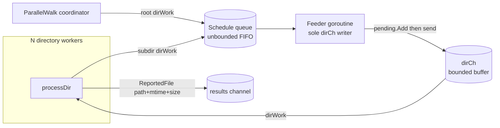

`restart_after_discovery` defaults to true and is hot-reloadable. After a
successful startup discovery run (walk, drain, and `file_folder_index` rebuild),
`App.runStartupDiscovery` schedules `PRAGMA optimize` and then, when
`restart_after_discovery` is true, calls `TriggerRestart()` (log reason
`discovery-complete`), unless the app is stopping. Do not wait for PRAGMA. `Service.Run` itself logs "File processing
completed" and does not restart. If `TriggerRestart` runs before the HTTP server
is listening, it sets the restart flag and production `RuntimeManager.Serve`
skips `ListenAndServe` (after `BeforeListen`, and again after the `httpServer`
assignment) so `Run` proceeds to `ExecRestart`. The exec injects
`SEPG_SKIP_STARTUP_DISCOVERY=1`, so the new process does not walk again. A
drain error or canceled discovery does not restart. Manual
`POST /server/discovery` does not auto-restart.

If startup discovery returns a **folder-index rebuild** failure
(`errors.Is(err, database.ErrFolderIndexRebuild)`), `App.runStartupDiscovery`
does **not** request a restart: a broken populate must not exec a
skip-discovery child that skips the rebuild next boot. It sends the error to
`Run` and cancels the app context, so `Run` returns the error and the process
exits with status 1 (see [§6.3](#63-server-lifecycle)). Startup discovery runs
on the runtime wait group, so `Shutdown` waits for it. `POST /server/discovery`
does not shut the server down: it records the error for the dashboard alert and
keeps serving.

### 7.2 File Processing Pipeline

Index: [§2 Process-to-package map](#2-process-to-package-map).

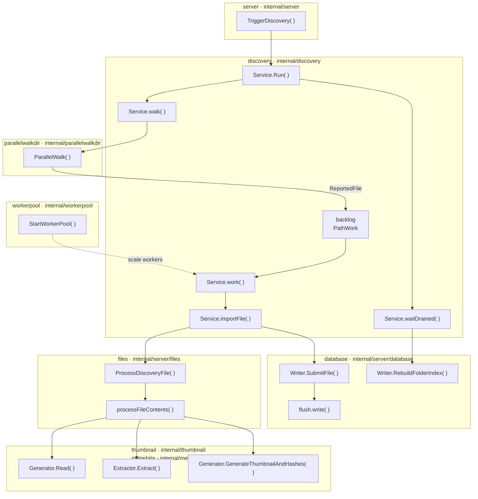

| Diagram label                              | Package            | Directory                             | Symbol / file                                                                  |
| ------------------------------------------ | ------------------ | ------------------------------------- | ------------------------------------------------------------------------------ |
| `TriggerDiscovery( )`                      | `server`           | `internal/server`                     | `server.go`; calls `Service.Run` with the app's context                        |
| `Service.Run( )`                           | `discovery`        | `internal/discovery`                  | `service.go`; walk, drain, save counters, rebuild the folder index             |
| `Service.walk( )`                          | `discovery`        | `internal/discovery`                  | `walk.go`                                                                      |
| `ParallelWalk( )`                          | `parallelwalkdir`  | `internal/parallelwalkdir`            | `parallelwalkdir.go`                                                           |
| `backlog` (`PathWork`)                     | `discovery`+`dque` | `internal/discovery`, `internal/dque` | `backlog.go`; opened and wiped by `discovery.New`                              |
| `StartWorkerPool( )`                       | `workerpool`       | `internal/workerpool`                 | `workerpool.go`; `Service.Start` runs `Service.work` under it                  |
| `Service.work( )`, `Service.importFile( )` | `discovery`        | `internal/discovery`                  | `worker.go`                                                                    |
| `Service.waitDrained( )`                   | `discovery`        | `internal/discovery`                  | `service.go`; waits for an empty backlog, no file in flight, no pending writes |
| `ProcessDiscoveryFile( )`                  | `files`            | `internal/server/files`               | `service.go`                                                                   |
| `processFileContents( )`                   | `files`            | `internal/server/files`               | `processor.go`; calls `thumbnail` and `metadata`                               |
| `Generator.Read( )`                        | `thumbnail`        | `internal/thumbnail`                  | `generator.go`                                                                 |
| `Extractor.Extract( )`                     | `metadata`         | `internal/metadata`                   | `extractor.go`                                                                 |
| `Generator.GenerateThumbnailAndHashes( )`  | `thumbnail`        | `internal/thumbnail`                  | `generator.go`                                                                 |
| `Writer.SubmitFile( )`                     | `database`         | `internal/server/database`            | `writer.go`                                                                    |
| `flush.write( )`                           | `database`         | `internal/server/database`            | `flush.go`; transaction body run by the `writebatcher` worker                  |
| `Writer.RebuildFolderIndex( )`             | `database`         | `internal/server/database`            | `folder_index.go`                                                              |

**Processing Steps** (`processFileContents`):

1. **Walk-only modification gate** - Unchanged images are filtered during the `parallelwalkdir` catalog compare; dequeued workers always process the file (no worker-side DB modification skip).
2. **Read** - `Generator.Read` reads the whole file once into a buffer the generator reuses. Reads of all generators share a 192 MiB in-flight byte budget, charged by the size the walk saw.
3. **MIME detection** - `http.DetectContentType` on the bytes. A type that does not start with `image` fails the file as `non-image`.
4. **Metadata extraction** - `Extractor.Extract` runs ExifTool on the file path and returns EXIF, IPTC, and XMP as plain Go values. An ExifTool error fails the file (reason `exif`).
5. **Image config** - `image.DecodeConfig` reads width and height.
6. **Thumbnail and hashes** - `Generator.GenerateThumbnailAndHashes` decodes the image, makes one thumbnail (size label `"m"`, fit in a 200x150 box, JPEG), and computes the MD5 of the file bytes and the pHash of the decoded pixels.
7. **Database write** - `importFile` submits the file to the `Writer`, which writes batches as described in [§5.1](#51-database-writer). A file that failed in steps 2 to 6 is submitted as an `InvalidFile` instead, if a fresh stat of it succeeds (see [§7.1.1](#711-discovery-walk-metadata-and-walk-only-gate)), with its reason: `non-image`, `decode`, `thumbnail`, `exif`, `open`, or `unknown` (`files.InvalidReason`). A file whose processing was canceled is not recorded, so the next run processes it again.

When the walk ends, `waitDrained` polls every 100 ms until no walk is queueing, the backlog is empty, no file is in flight, and the Writer has no pending writes. `Run` then saves the run counters to `module_state` and calls `Writer.RebuildFolderIndex`. A rebuild error is returned from `Run` (wrapping `database.ErrFolderIndexRebuild`).

#### Discovery processing stats (dashboard metrics)

[`discovery.Stats`](../internal/discovery/stats.go) feeds [`FileProcessingMetrics`](../internal/server/metrics/collector.go) on the admin dashboard (`total_found`, `already_existing`, `newly_inserted`, `skipped_invalid`, `in_flight`). `Run` zeroes the four run counters at its start, saves them to `module_state` when the drain ends, and `Service.Hydrate` loads the saved values at startup when startup discovery is skipped.

| Counter               | During a discovery run                                                                                                                                                             |
| --------------------- | ---------------------------------------------------------------------------------------------------------------------------------------------------------------------------------- |
| **`TotalFound`**      | Incremented once per regular image file that passes walk filters at the DirEnt catalog gate (`Service.modified`).                                                                  |
| **`AlreadyExisting`** | Incremented at walk when `decide` classifies the file as unchanged in **`files`** (mtime, size, and MD5 present).                                                                  |
| **`SkippedInvalid`**  | Incremented at walk for unchanged **`invalid_files`** rows; incremented in **`Service.recordInvalid`** when processing fails and the invalid record is submitted.                  |
| **`NewlyInserted`**   | Incremented in `Service.importFile` for every file that **`ProcessDiscoveryFile`** processed, before **`Writer.SubmitFile`** (unchanged valid and invalid files are not dequeued). |
| **`InFlight`**        | Incremented when a worker takes a file from the backlog (`claim`), decremented when `importFile` returns. `Run` does not reset it.                                                 |

**Conservation (per run):** `TotalFound == AlreadyExisting + SkippedInvalid + NewlyInserted` once the walk and worker drain finish, provided every path the catalog gate selected for processing was enqueued on the backlog (after an enqueue error the walk discards the remaining reports, which were already counted), no file was canceled, and every invalid record was submitted (`SkippedInvalid` counts both walk-time unchanged invalid rows and worker-recorded failures; `NewlyInserted` counts only successful processing).

**Thumbnail decode (`GenerateThumbnailAndHashes`):**

- **PNG and GIF** (by sniffed MIME type) decode with Wuffs (`wuffs-wasm`) into 8-bit premultiplied RGBA; a GIF decodes as its first frame at the frame's bounds. The decoder is reused from file to file. A decode with more than 4 MiB of output is followed by `Trim`, and a failed decode closes the decoder.
- **JPEG** decodes with go-scaled-jpeg at an **adaptive DCT scale** (`chooseJPEGDCTSize`): the scale is chosen from the source dimensions (read in step 5) so the decoded JPEG is at least the 200x150 gallery-thumb fit size, or full size if the source is smaller. Large JPEGs decode at 1/8 (`DCTSizeScaled: 1`); small JPEGs decode closer to 1:1, at most full size. The DCT scale reduces the intermediate decode size; the decoded image is then resized to fit. An original smaller than the 200x150 box is enlarged to fit it (`fitInsideBoxDims`). A JPEG decode error **hard-fails** the file: there is no stdlib `image/jpeg.Decode` fallback.
- **Other formats** go through the standard `image` registry. The `thumbnail` package registers WebP (`golang.org/x/image/webp`); a format with no registered decoder fails.
- **Resize and encode** - the decoded image is scaled with `draw.ApproxBiLinear` into a reused canvas and encoded with stdlib `image/jpeg.Encode` (go-scaled-jpeg is decode-only).
- **pHash** - `go-image-phash` computes a 64-bit hash from the decoded pixels (for a JPEG, at the DCT-scaled size). If the hash cannot be computed, it is logged and stored as 0.
- **Memory** - a `thumbnail.Pool` shares its budgets across generators: up to 256 MiB (`RetainedBytes`) of scratch memory kept between files, and one slot at a time for a decode that needs more than the retained size. Wuffs decoder memory is outside the Go heap: a generator keeps its decoder, trims it after a decode with more than 4 MiB of output, and closes it after a failed decode.

### 7.3 Task Scheduler

**Packages:** `scheduler` (`internal/scheduler`); primary caller for gallery preload is `cachepreload` (`internal/server/cachepreload`). See [Process-to-package map § Caching and scheduled tasks](#24-caching-and-scheduled-tasks).

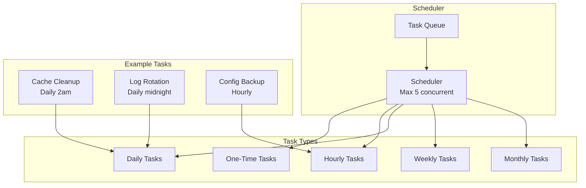

**Scheduler Features:**

- Drift-free intervals (won't skip scheduled times)
- Context-based cancellation (graceful shutdown)
- Error isolation (task errors don't stop scheduler)
- Configurable concurrency (0 means `runtime.NumCPU()`; defaults to `runtime.NumCPU()` if created with 0)

---

## 8. Caching Strategy

**Packages:** [Process-to-package map § Caching and scheduled tasks](#24-caching-and-scheduled-tasks) (`cachelite`, `bodycodec`, `cachepreload`, `cachebatch`, `scheduler`).

SFPG uses a sophisticated multi-layer caching strategy:

### 8.1 Cache Architecture Overview

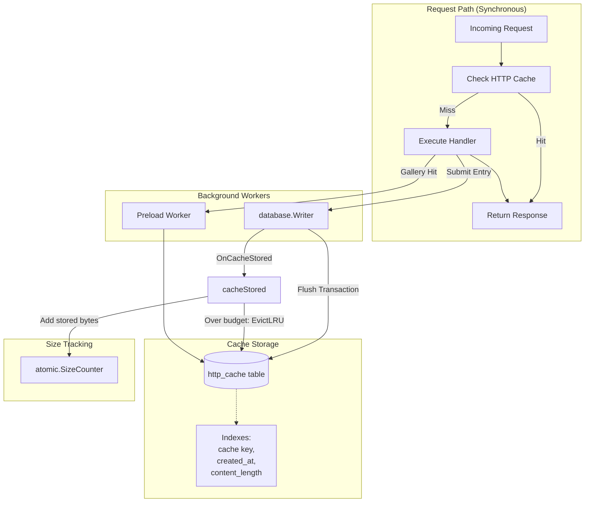

### 8.2 HTTP Cache (cachelite)

**Purpose:** Persist entire HTTP responses (headers + body) in SQLite

**Table rotation:** `RotateCacheTable` uses `internal/tableswap`
(`CloneEmpty`, `CreateIndexes` on one RW pool lease; `Swap` on a dedicated
`*dbconnpool.CpConn` that `Swap` Puts after `DROP TABLE`).
`CreateIndexes` sets `PRAGMA temp_store=FILE` on the leased RW connection before
`CREATE INDEX`, then restores the previous `temp_store` (data source name (DSN) stays `memory` for
other work).
Destination is `http_cache_new`. After cutover, `Swap` `DROP TABLE`s
`http_cache_to_be_dropped` before it returns (a prior leftover stale table is
dropped inside the cutover transaction before the renames).
First `CreateIndexes` while live indexes exist allocates `idx_http_cache_*_1`
(SQLite index names are database-global). Callers must set `PRAGMA busy_timeout`
(gallery RW DSN already does).

**Cache Key:** `METHOD:/path?query|Variant=<name>`

The key includes:

- HTTP method and path
- Query string — for `/gallery/`, `/lightbox/`, and `/info/` paths, **only the `v` param** (ETag cache-bust) is included; unrelated params are stripped from the key and from the stored `query_string` column. Other cacheable paths keep the full raw query.
- Normalized variant name (`full`, `gallery-content`, `box_info`, `lightbox-ui`)
- **No theme** — theme is a client-only cookie; SSR always uses the site default (`CurrentTheme`)
- **Body compression** — bodies may be **compressed at rest** in SQLite (zstd-1 by default); clients still receive plaintext; wire compression remains at Caddy
- **No HTMX headers** — info/lightbox paths collapse to one variant regardless of HTMX; gallery distinguishes full vs `gallery-content`

Examples:

```
GET:/gallery/1?v=3|Variant=gallery-content
GET:/gallery/1?v=3|Variant=full
GET:/lightbox/1?v=2|Variant=lightbox-ui
GET:/info/folder/1?v=1|Variant=box_info
```

**Cacheable Routes:** `/gallery/`, `/lightbox/`, `/info/folder/`, `/info/image/`

**Cache vs auth guardrail:** Cache keys intentionally exclude session/auth state (and theme; see above). HTML for cacheable gallery/lightbox routes must not vary on whether the viewer is logged in — otherwise one user's cached page could leak to another. Today this holds: `IsAuthenticated` appears only in the hamburger menu HTMX partial (`hamburger-menu-items.html.tmpl`), not in cacheable full-page or gallery-content variants. Do not add per-user markup to cacheable templates without also changing cache keying or disabling cache for that route.

**Cache Flow:**

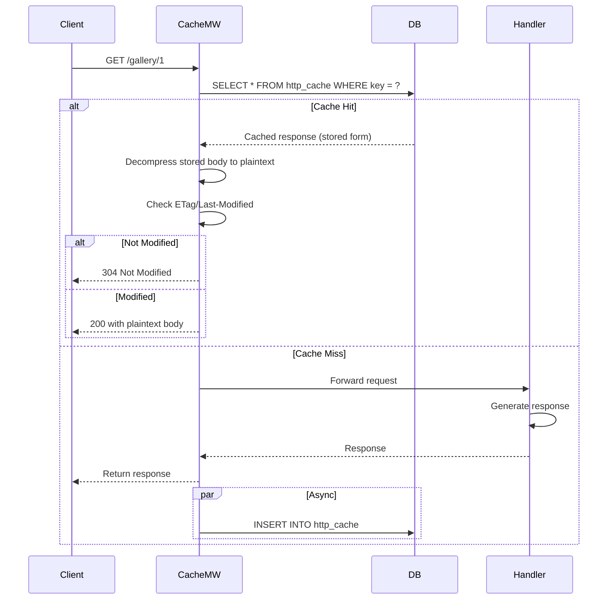

### 8.3 Cache Body Compression

HTTP cache response bodies may be **compressed at rest** in SQLite using a pluggable codec registry. This reduces the disk footprint of large cached gallery pages (samples up to ~10 MB each) without changing the on-wire representation.

- **No migration.** Read dispatch uses magic-prefix matching (primary) + `htmlsniff` (plaintext fallback). Legacy plaintext HTML rows (no compression magic) still HIT.
- `content_length` column stores the **uncompressed** size (HTTP `Content-Length` on replay; `MaxEntrySize` check).
- Disk accounting (`GetHttpCacheSizeBytes`, least-recently-used (LRU) eviction, Writer `OnCacheStored`) uses **stored** bytes (`LENGTH(body)` / `len(Body)`).
- **Default write codec:** `zstd-1`. Configurable via `http_cache_body_codec` (YAML/DB/modal only; no `SFG_` env variable — same pattern as `etag_version`).
- Typical profile (~10 MB gallery page): encode ~56 ms, decode ~14 ms; `Match` + `htmlsniff` ≪1 ms per request.
- **`ErrUnrecognizedCacheBody`** (corrupt or unclassifiable blob) → MISS. The middleware logs a warning and falls through to handler re-render, which overwrites the bad row on store.

**Implementation lives entirely inside `internal/cachelite/`:**

- `body_storage.go` — `ConfigureBodyCodec`, `FinalizeForStorage`, `decodeCacheBodyForServe`
- `bodycodec/` — pluggable codec registry, `zstd-1`, `gzip-6`, `htmlsniff`
- No registry fields on `App` / `InfrastructureService`; configured via `cachelite.ConfigureBodyCodec()`.

**Cache Eviction:**

Cache eviction happens **after a successful batch flush that stored cache entries**, in the `OnCacheStored` callback (`InfrastructureService.cacheStored`):

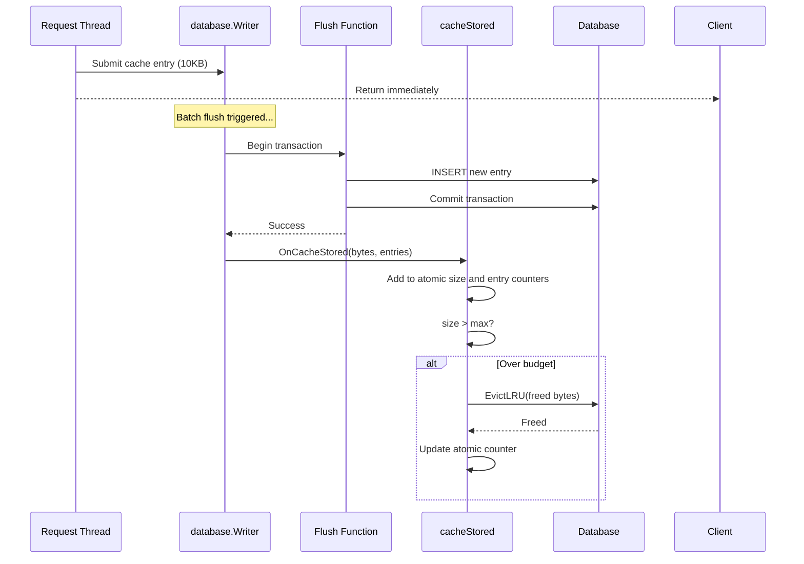

**Design Notes:**

- Eviction happens **outside the transaction** to avoid SQLite deadlocks
- The atomic counters are estimates of the cache size: each store adds the full body size and one entry, so replacing an existing key overcounts until the next recalibration. They are loaded from the database at startup and after a failed cache flush, and adjusted on each store and eviction
- 10% buffer added to eviction target to avoid thrashing
- The counters are lowered by the bytes and entries each eviction frees
- WAL checkpoints and periodic `PRAGMA optimize` are described in [§5.1](#51-database-writer); `PRAGMA optimize` runs from the Writer's maintenance every `DBOptimizeInterval` (default 1h)

### 8.4 Cache Preload

When a gallery page is requested, the system preloads related pages in the background:

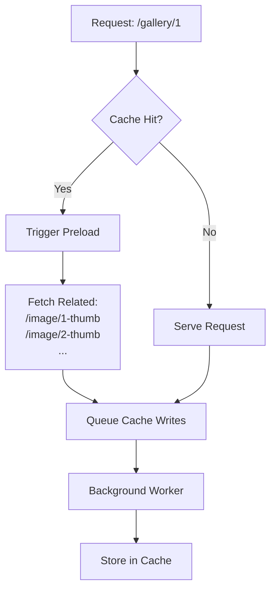

**Preload Strategy:**

- Only cache hits trigger preload
- Preloads thumbnail images for the gallery
- Skips if client sends `X-Preload: skip` header
- Prevents thundering herd on first access

### 8.5 Client-Side Caching

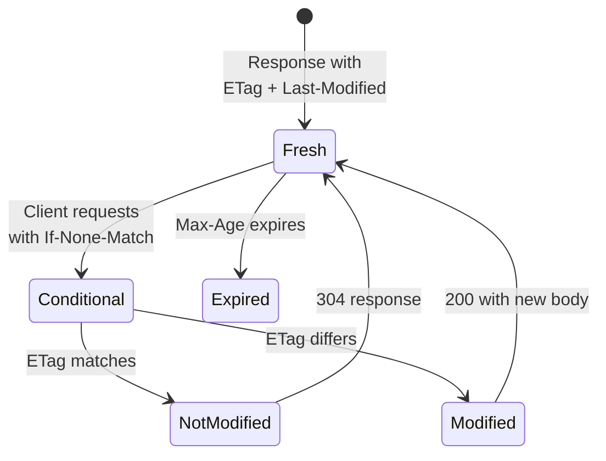

**Headers Set (gallery / lightbox):**

- `ETag`: `"<etagVersion>-<folderID>"` (content version + resource id; no theme or encoding)
- `Last-Modified`: File modification time
- `Cache-Control`: `public, max-age=2592000` (gallery full page) or handler-specific; gallery **layout partial** responses use `no-store` via `ui.SetPartialNoStore` (overwrites gallery cache headers). Dashboard layout partial `Cache-Control` / `Vary`: [HTMX HTML responses](#htmx-html-responses) table.
- `Vary`: `HX-Request`, `HX-Target` on gallery (partial vs full page); not `Cookie` or `Accept-Encoding`. Authenticated routes also run `authMiddleware` HTMX cache policy (`Vary: HX-Request`, `HX-Target` when `HX-Request: true`) before handlers add layout-partial headers.

---

## 9. Security Model

**Packages:** [Process-to-package map § Web request path](#21-web-request-path) (`auth`, `session`, `security`, `middleware`; cross-origin checks via `net/http` `CrossOriginProtection` wired in `internal/server/router.go`).

### 9.1 Defense in Depth

**Response headers (app middleware):** Every response includes `X-Content-Type-Options: nosniff` and `Content-Security-Policy: frame-ancestors 'none'` (`middleware.SecurityHeaders` on the main handler chain). Stock Caddy examples add HTTP Strict Transport Security (HSTS) at the edge; nosniff and frame-ancestors are set by the Go app so direct `:8081` / `air` dev behave the same.

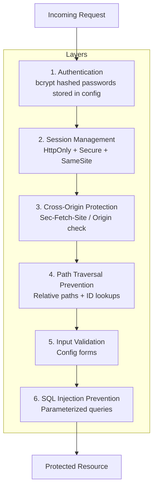

### 9.2 Authentication Flow

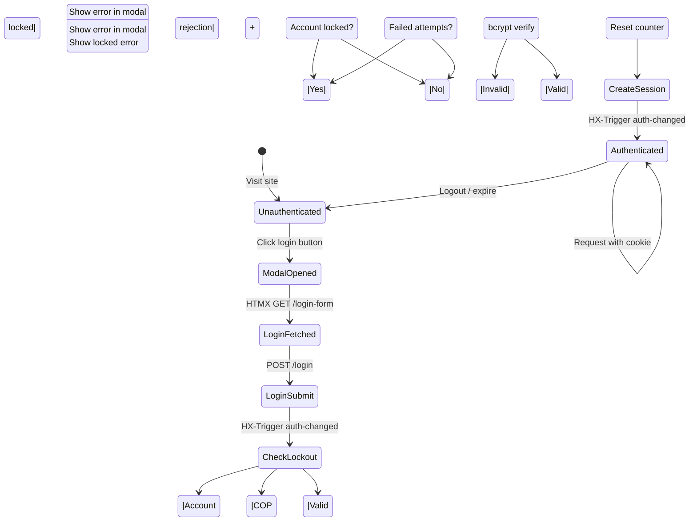

**Account Lockout:**

- Credentials are stored in the `config` table (keys `user` and `password`), not in a separate `admin` table
- Threshold: configurable via `lockout_threshold` (default 3 failed attempts per account; minimum 1)
- Duration: configurable via `LockoutDuration` (`lockout_duration`, default 1 hour)
- Automatic unlock after duration
- Configured in the config modal **Session** tab under **Login security** (hot reload, no restart)

**IP login rate limiting:**

- Limits `POST /login` attempts per client IP per **60-second sliding window** (`internal/server/security/ratelimit.go`)
- Config key: `login_rate_limit_per_ip` (default **10**; **`0` disables** IP rate limiting)
- Enforced in `AuthHandlers.Login` **before** authentication (each POST counts, including failed auth)
- Uses `RemoteAddr` only (not `X-Forwarded-For`); behind a reverse proxy all clients may share the proxy IP unless the app sees distinct connection addresses
- Hot reload: `SyncLoginRateLimitMax` on config apply (`SetMax` + `Clear` on one limiter instance)
- Startup override: `SEPG_LOGIN_RATE_LIMIT_PER_IP` (see [ENV_CONFIGURATION.md](../ENV_CONFIGURATION.md)); no CLI flag
- Complements per-account lockout (IP cap vs. account lockout are independent)

### 9.3 Cross-Origin Protection (COP)

Cross-site request forgery protection is handled entirely by the
`http.CrossOriginProtection` middleware. It does **not** use session tokens.

**How it works:**

- For unsafe methods (POST/PUT/DELETE/PATCH), the middleware validates the request
  origin via `Sec-Fetch-Site` header (preferred) or `Origin` header (fallback)
- The request origin must match the configured host, or be same-site
- `Host` header is preserved through reverse proxies so same-origin checks work
  behind Caddy / nginx (see [`DEPLOYMENT.md`](../DEPLOYMENT.md) and
  [`deploy/Caddyfile`](../deploy/Caddyfile); local smoke:
  [`deploy/Caddyfile.local`](../deploy/Caddyfile.local) +
  [`scripts/caddy-smoke.sh`](../scripts/caddy-smoke.sh))
- Wire compression is Caddy `encode zstd gzip` (not in-app); brotli needs a custom Caddy build
- Safe methods (GET/HEAD/OPTIONS) are allowed unconditionally
- No session token generation, no hidden form fields, no per-session state

**Why this approach:**

- Cache-friendly: cached responses do not embed per-session tokens
- Simpler architecture: no token generation, storage, or validation in request path
- Sufficient for a self-hosted app where the attack surface is a local network or
  limited domain

### 9.4 Path Traversal Prevention

**Problem:** Prevent `../../../etc/passwd` attacks

**Solution 1: Relative Paths**

```
Database stores: "gallery/vacation/photo.jpg"
Joined with:    "/var/lib/sfpg/images"
Result:         "/var/lib/sfpg/images/gallery/vacation/photo.jpg"
```

**Solution 2: ID-Based Lookups**

```go
// Handler receives: /image/123
// Database lookup: SELECT * FROM files WHERE id = 123
// Returns path:     "gallery/vacation/photo.jpg"
// Construct:        /var/lib/sfpg/images/gallery/vacation/photo.jpg
```

**Solution 3: Path Validation**

Serving and discovery use `pathutil.SafeImagePath` (absolute join + prefix check) so `../` cannot escape `image_directory`. Import/discovery paths are normalized with `pathutil.RemoveImagesDirPrefix` (reject `..` segments and absolute paths outside the images root).

```go
// SafeImagePath — used before opening files for serve/thumbnail
absPath, err := pathutil.SafeImagePath(imagesDir, filePath)
if err != nil {
    // ErrPathTraversal, ErrInvalidPath, or ErrInvalidImagesDir
}

// RemoveImagesDirPrefix — used when storing relative paths in the DB
rel, err := pathutil.RemoveImagesDirPrefix(normalizedImagesDir, path)
```

---

## 10. Configuration Management

**Packages:** [Process-to-package map § Configuration and CLI](#25-configuration-and-cli) (`config`, `validation`, `getopt`).

### 10.1 Configuration Sources & Precedence

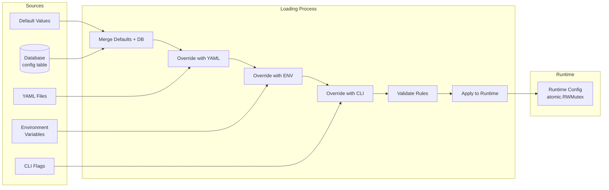

**Precedence (highest to lowest):**

1. CLI flags (`--port=8080`, `-log-level=debug`)
2. Environment variables (`SFG_PORT=8080`, `SFG_LOG_LEVEL=info`)
3. YAML files (`config.yaml`)
4. Database values (from `/config` page)
5. Default values (hardcoded)

The precedence inside `getopt.Parse()` is specifically CLI > Environment. `config.Load()` then applies Defaults → Database → YAML → CLI/Env.

### 10.2 Precedence Hardening Guarantees (Mar 2026)

The startup and reload paths now document and enforce an explicit contract for pool-related settings.

Bug fixed:

- Symptom: `DBMaxPoolSize=500` was saved in the database, but active pools stayed at `100`.
- Root cause: `setDB()` executed before `loadConfig()`, so pools were created while `app.config` was `nil` and fell back to default pool sizing.
- Fix: `loadConfig()` now updates `app.config` and then calls `reconfigurePoolsFromConfig()` to recreate pools when loaded values differ from the effective (clamped) values.
- Prevention: dedicated precedence/startup/restart/UI regression tests plus startup diagnostics that explicitly log configured versus effective pool values.

Required sequencing constraint:

- `setDB()` may run before full config load to bootstrap database access.
- `loadConfig()` must run before normal serving and must be followed by `reconfigurePoolsFromConfig()` semantics.
- Any startup/restart path that loads or restores config must ensure pool reconciliation runs afterward.

Operational reconfiguration behavior:

- Triggered automatically at the end of `loadConfig()`.
- Triggered after `-restore-last-known-good` restores configuration.
- Triggered in fallback startup flows that synthesize defaults after config load failure.
- Pool recreation is skipped only when live max connections, min idle connections, and monitor interval all match the effective values — the interval comparison applies the `<= 0` → `1m` clamp, so a configured `db_pool_monitor_interval=0` matching a live `1m` monitor is a no-op.

Diagnostic logging for mismatch visibility:

- `pool config applied`: emits configured and effective RW/RO pool values, including the monitor interval keys `rw_configured_monitor_interval`, `rw_effective_monitor_interval`, `ro_configured_monitor_interval`, and `ro_effective_monitor_interval` (configured side is the raw config value, which may be `0`; effective side is the clamped live value).
- `configured/effective DB pool mismatch`: emits warning-level diagnostics when values diverge. A configured `db_min_idle_connections=0` is applied as effective 0 (no idle connections), not auto-sized; the default is 10. Mismatch warnings still apply when the configured min idle exceeds the max pool size.
- `startup config summary`: emits one low-noise startup snapshot of configured versus effective values for DB pools and other critical subsystems, including `db_configured_monitor_interval`, `db_rw_effective_monitor_interval`, and `db_ro_effective_monitor_interval` (configured is the raw config value; effective is the live pool interval, `0` when the pool has not been created yet).

Regression protections (consolidated root integration tests):

- Pool precedence and startup/restart sizing (`config_lifecycle_integration_test.go`):
  - `TestDBPoolPrecedence_PoolsIgnoreDatabaseConfig`
  - `TestDBPoolPrecedence_ConfigLoadedAfterPoolCreation`
  - `TestStartupWithDBConfig_PoolSizeHonored`
  - `TestRestartWithModifiedDBConfig_AppliesNewValues`
  - Prevents pools from staying on defaults or ignoring database config after restart.
- Broader precedence (`config_precedence_integration_test.go`):
  - `TestConfigPrecedence_*`, `TestCLI_*`, `TestConfigImport_*`
  - Prevents precedence drift across defaults/database/env/CLI layers.
- Config save/restart UI coverage:
  - Handler structure: `internal/server/handlers/config_post_test.go` and related handler tests (`ValidateHTMXResponseStructure` on restart-required responses; success message is main swap, badge OOB without `hidden`)
  - User-visible restart dialog: Playwright `expectRestartDialogOpen` in `tests/config-helpers.ts`; full save → restart flow in `tests/config.spec.ts` ("Config restart") and `tests/server-actions.spec.ts` ("Server restart")
  - Field-specific and UX paths: `tests/config.spec.ts` "13a: db_max_pool_size save opens restart dialog" (number field, not checkbox-only); "13b: Cancel after restart-required save closes cleanly" (originals snapshot refreshed after save)
  - HTMX swap contract (no full admin round-trip): `tests/htmx-restart-alert.spec.ts` — reads `config-save-restart-alert.html.tmpl` from disk and asserts badge loses `hidden` after outerHTML/OOB processing (`air` on `:8083` prerequisite)
  - Persistence-only: `web-testsuite/config_modal_test.go` (HTTP-level; does **not** cover the restart modal UX)
  - Prevents config UI regressions from silently breaking persistence or restart signaling.
- Pool monitor bootstrap and reconfigure skip:
  - `TestCreateDatabasePools` (extended asserts)
  - `TestCreateDatabasePools_MinIdleZero`
  - `TestCreateDatabasePools_ZeroIntervalClampedToDefault`
  - `TestCreateDatabasePools_PositiveIntervalApplied`
  - `TestInfrastructureService_ReconfigurePools_NoOpWhenUnchanged` (updated)
  - `TestInfrastructureService_ReconfigurePools_RecreatesWhenOnlyIntervalDiffers`
  - `TestInfrastructureService_ReconfigurePools_NoOpWhenConfiguredIntervalZeroMatchesClampedLive`
  - `TestDBPoolMonitorBootstrap_NilSetDBLoadDefaultsLiveInterval`
  - `TestInfrastructureService_LogDBPoolConfiguredVsEffective_NormalPath` (keys)
  - `TestLogStartupConfigSummary_EmitsConfiguredVsEffective` (keys)
  - `TestMonitor_ContinuesAfterEmptyShrinkDefault`
  - Prevents nil-config / `<= 0` interval regressions, the skip-interval reconfigure bug, monitor-interval log key drift, and monitor shutdown on empty-channel shrink.

### 10.3 Configuration Schema

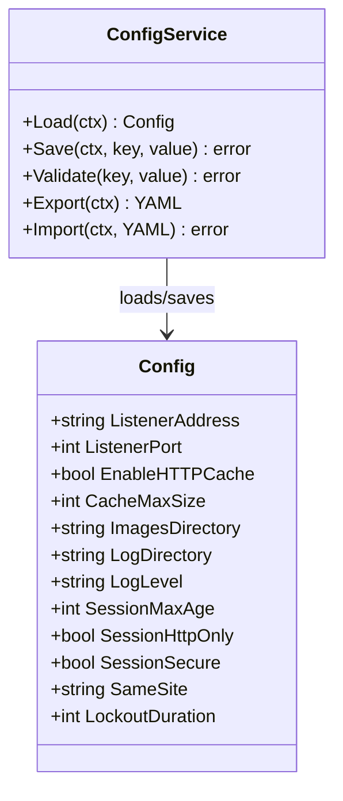

### 10.4 Hot Configuration Changes

Some configuration changes can be applied without restart:

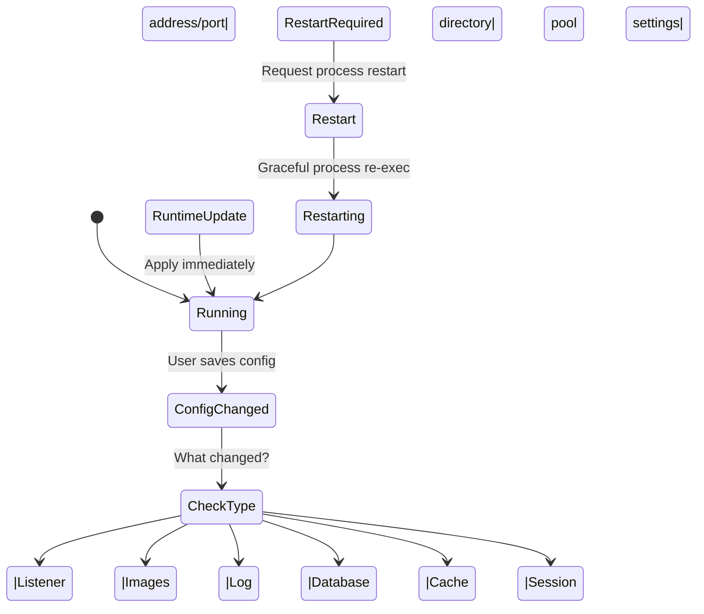

**Restart behavior:**

A web-triggered restart is a full process re-exec (`syscall.Exec`). The running
process shuts down its HTTP server, attempts to flush the Writer's in-memory writes (records queued on disk stay there for replay; see [§5.1](#51-database-writer)), closes database pools,
and replaces itself with a fresh process image. The new process reloads
configuration from the database and reinitializes all runtime services (HTTP cache,
worker pool, batch-load manager, etc.). There is no longer a separate "HTTP-only"
listener reload.

**Pool settings need a restart.** `db_max_pool_size`, `db_min_idle_connections`, and `db_pool_monitor_interval` are marked as requiring a restart. The `database.Writer` keeps the pools it was started with, so `InfrastructureService.ReconfigurePools` refuses to run once the Writer has started; pools are sized only at startup (see [§5.3](#53-connection-pool-design)).

---

## 11. Utilities & Libraries

### 11.1 Reusable Components

#### 11.1.1 workerpool

**Purpose:** Dynamic worker pool with auto-scaling

```go
pool := workerpool.NewPool(ctx, db, 0, 0, 10*time.Second)
pool.AddTask(task)  // Blocks if queue full
pool.Shutdown()     // Drains queue then exits
```

**Features:**

- Bounded queue (10,000 capacity)
- Idle workers exit after timeout
- Graceful shutdown (drains queue)
- Statistics (active workers, queue size)

#### 11.1.2 scheduler

**Purpose:** Cron-like task scheduler

```go
sched := scheduler.NewScheduler(5)  // Max 5 concurrent
sched.AddTask(task, scheduler.Daily, time.Now())
sched.Start(ctx)  // Blocks until ctx cancelled
```

**Features:**

- One-time, hourly, daily, weekly, monthly tasks
- Drift-free intervals
- Context-based cancellation
- Error isolation

#### 11.1.3 writebatcher

**Purpose:** Generic, transaction-batching write serializer with optional persistent overflow

```go
wb, err := writebatcher.New[MyItem](ctx, writebatcher.Config[MyItem]{
    BeginTx:      func(ctx context.Context) (*sql.Tx, error) { ... },
    Flush:        func(ctx context.Context, tx *sql.Tx, batch []MyItem) error { ... },
    OnSuccess:    func(batch []MyItem) { ... }, // Optional cleanup
    MaxBatchSize: 100,
    DQueDirPath:  "/var/lib/sfpg/overflow",   // optional: persistent overflow queue
})
wb.Submit(item)
```

**Benefits:**

- Eliminates write contention on single-writer databases like SQLite
- Automatically flushes on size (count or bytes), interval, or Close()
- Single background worker handles all flushes synchronously
- When `DQueDirPath` is set, tries to overflow the in-memory channel to `dque` (absorbs bursts; queued items stay on disk at close). `Submit` returns `ErrQuotaExceeded` at the disk quota and `ErrFull` when the disk enqueue fails

`database.Writer` is its production user: it supplies `BeginTx`, `Flush`, and the other callbacks, and starts the batcher with a `dque` overflow directory (see [§5.1](#51-database-writer)).

#### 11.1.4 dque

**Purpose:** Generic, segment-backed persistent on-disk FIFO (first-in, first-out) queue

```go
q, err := dque.New[Item]("name", dirPath, itemsPerSegment)
q.Enqueue(&item)   // append
item, err := q.Dequeue()
q.Size()
```

**Features:**

- Segment-based storage (tunable items per segment)
- File locking via `internal/flock` (single accessor per directory)
- Used by `writebatcher` for durable overflow and crash recovery
- Backs the production discovery work queue as a disposable wipe-on-start backlog (`discovery-dque/` in the database directory, e.g. `DB/discovery-dque/` beside the main database file; distinct from the writebatcher `<db>-dque/` overflow dir)

#### 11.1.5 flock

**Purpose:** Minimal cross-platform file locking (flock on Unix, `LockFileEx` on Windows). Used by `dque` to ensure a single accessor per queue directory.

#### 11.1.6 gallerylib

**Purpose:** File import logic — `Importer` performs path-chain upserts (folders + file record) and tracks which directories already had their folder-tile chain updated. Constructed once per write batch and reused across files so its `folderCache` and `tiledDirs` memoize across the batch.

#### 11.1.7 queue

**Purpose:** Thread-safe dynamically-resizing deque

```go
q := queue.New[string]()
q.PushBack("item")     // Add to back
q.PopFront()           // Remove from front
q.Len()                // Current size
```

**Features:**

- O(1) push/pop from both ends
- Auto-grows by powers of 2
- Auto-shrinks when < 25% full
- Zero allocations after warmup

#### 11.1.8 gensyncpool

**Purpose:** Reduce allocations with sync.Pool

```go
pool := gensyncpool.NewPool(func() *Item {
    return &Item{}
})
item := pool.Get()
// ... use item ...
pool.Put(item)  // Return to pool
```

**Used For:**

- `[]byte` buffers (read/write buffers)
- `HTTPCacheEntry` objects (cache responses)
- Reduces GC pressure significantly

#### 11.1.9 dbconnpool

**Purpose:** SQLite connection pooling with write-ahead logging (WAL) mode

```go
pool, err := dbconnpool.NewDbSQLConnPool(ctx, dsn, cfg)
cpc, err := pool.Get()
// ... use cpc ...
pool.Put(cpc)
```

**Features:**

- Separate read/write pools
- WAL mode enabled
- Connection validation
- Graceful shutdown

**Memory test database mode (`dbconnpool.Config.TestUseMemDB`):** Package tests opt in via `TestMain` (see `internal/server/config/testdb_test.go`): set `TestUseMemDB: true` on the `dbconnpool.Config` and call `NewDbSQLConnPool` with an **empty** DSN to select memory mode. A non-empty DSN selects normal file-backed mode even when the flag is true. Each schema key owns one shared `internal/testdb.MemoryDatabases` lease: construction materializes main immediately and reserves its fresh thumbs peer, while `ThumbsURI` materializes thumbs once on first use. Callers use only the `MainURI`/`ThumbsURI` URIs and never assemble SQLite URIs themselves. Main and thumbs live as separate named, memory-resident `memdb` VFS images, each restored from a process-local seed with SQLite's backup/restore API; each pool connection attaches the thumbs image per connection. RW and RO pools use distinct `*sql.DB` handles over the same image, and RO handles use SQLite read-only mode. The slot keeps shared-pool ownership and calls `Close` only on final release; there is no live disk copy and no repository-local fixture. File-backed test copies use `dbconnpool.CopyMainTestDatabaseTo` / `CopyThumbsTestDatabaseTo`, which copy from a short-lived memory pair.

#### 11.1.10 metadata

**Purpose:** EXIF, IPTC, and XMP extraction with ExifTool, returned as plain Go values (`metadata.Info`).

`metadata.Extractor` ([`internal/metadata`](../internal/metadata/extractor.go)) runs ExifTool in one of two ways, chosen once per process. If an `exiftool` of 13.00 or later is on `PATH`, it runs that executable through [`github.com/ncruces/go-exiftool`](https://github.com/lbe/go-exiftool) (a fork pinned by a `replace` directive): one server, in a separate process. Otherwise it runs the embedded WebAssembly build of ExifTool through [`github.com/lbe/go-exiftool-wasm`](https://github.com/lbe/go-exiftool-wasm), so no external `exiftool` is needed.

- **Pool:** `New` returns an `Extractor` that runs one native server, or up to `e.WASMServers()` WASM servers at once (0 for the native ExifTool): one per three CPUs, from 2 to 4. WASM servers start on first use. A background goroutine shuts down servers idle for 30 s or more, checked every 30 s; `Close` stops it and waits. The caller that calls `New` owns the `Extractor` and closes it. `files.NewFileProcessor` takes one and does not close it.
- **Command:** `Extract(ctx, path)` runs one ExifTool command on the file path with JSON output, group names, numeric values, every tag, and the raw XMP packet. It excludes five embedded-image tags (`ThumbnailImage`, `PreviewImage`, `PhotoshopThumbnail`, `JpgFromRaw`, `OtherImage`).
- **Retirement:** a server is shut down instead of reused after a command error. A WASM server is also shut down after a file of 16 MiB or more, or a result of 1 MiB or more, because its memory grows to the largest input and never shrinks. A native server's memory is in its own process, so it is kept.
- **Result:** `Info` holds `Exif`, `IPTC` (including keywords), and `XMP` (the raw packet and GPS strings). `files.processFileContents` calls `Extract`; `database.Writer` replaces the stored EXIF, IPTC, and XMP rows of a file from the result (`writeMetadata`).
- **Errors:** an error reported by ExifTool for the file is returned, and the file is recorded in `invalid_files` with reason `exif`. `ErrClosed` is returned after `Close`.

#### 11.1.11 osza

**Purpose:** Directory listing and zero-allocation `Lstat`/`Stat` into caller-owned buffers (`fs.DirEntry`-compatible entries; `fs.FileInfo` metadata via `FileMeta`). Used by `parallelwalkdir` for discovery; intended for hot paths that avoid per-call heap traffic on stat and per-entry traffic on Unix `ReadDir` when dirent types are known.

**Layout:**

| Path                             | Role                                                                                                                                 |
| -------------------------------- | ------------------------------------------------------------------------------------------------------------------------------------ |
| `internal/osza` (`package osza`) | Stable API: `doc.go`, `*_export.go` (`readdir_export.go`, `stat_export.go`)                                                          |
| `internal/osza/readdir`          | `ReadDir` implementation (Unix `ReadDirent`, Windows `FindFirstFile`)                                                                |
| `internal/osza/stat`             | `LstatAt`/`StatAt`/`LstatJoin`/`StatJoin` into reused `FileMeta` (Unix syscall / Windows Win32); does not import facade or `readdir` |
| `internal/osza/README.md`        | Maintainer guide (layout, tests, adding submodules)                                                                                  |

**Usage:**

```go
import "github.com/lbe/sfpg-go/internal/osza"

dirPath := make([]byte, len(dir)+1)
dirLen, err := osza.CopyDirPath(dirPath, dir)
entries := make([]osza.Entry, 256)
nameBuf := make([]byte, 64*1024)
scratch := make([]byte, 8192)
joinBuf := make([]byte, 64*1024)
n, err := osza.ReadDir(dirPath, dirLen, entries, nameBuf, scratch, joinBuf)
```

**Contracts:**

- `Entry.Name` (`[]byte`) points into `nameBuf`; invalid after buffer reuse.
- `Entry.IsDir`, `Type`, and `Info` match `os.ReadDir` on the current GOOS; call `entries[i].Info(joinBuf)` for Unix lazy-stat caching.
- `ErrOverflow`: partial fill in `entries[:n]`; caller doubles `entries` and `nameBuf` and re-reads from scratch (see `internal/osza/example/read_dir_retry/main.go`).
- `ErrPathBuffer` during `ReadDir` (Unix unknown dirent types): partial `entries[:n]`; enlarge `joinBuf` and re-read.
- `ErrShortScratch` on Unix when `len(scratch) < 8192`. Windows: `scratch` ignored (may be `nil`).
- `dirPathBuf`, `joinBuf`, and `scratch` must not alias; one buffer set per goroutine (temporary NUL writes during syscalls).

**Stat (`stat_export.go` / `internal/osza/stat`):**

- Caller-owned `pathBuf`/`joinBuf` and reused `*FileMeta`; one buffer set per goroutine.
- `*At`: path is `pathBuf[:pathLen]` (UTF-8); Unix may use a trailing NUL in buffer capacity at `pathLen`.
- `*Join`: parent bytes at `joinBuf[:parentLen]`, name at `joinBuf[parentLen:parentLen+nameLen]`; join in place then stat; `ErrPathBuffer` when capacity is insufficient.
- `FileMeta` implements `fs.FileInfo`; **`Name()` always returns `""`** — paths are not stored on `FileMeta` (metadata only on the hot path).
- Errors: syscall failures → `*fs.PathError`; `errors.Is` for `ErrPathBuffer`, `ErrNilFileMeta`.
- Linux gates and 0-alloc bench bar: [osza-stat-signoff.md](osza-stat-signoff.md).

**Extending:** New capability → `internal/osza/<name>/` + `<name>_export.go` at facade root; same buffer and sentinel-error conventions.

#### 11.1.12 memlimit

**Purpose:** Set the Go soft memory limit from the machine's RAM and what the process needs memory for, and size the discovery worker count to fit.

`memlimit.Apply(Need)` ([`internal/memlimit`](../internal/memlimit/memlimit.go)) runs once, from `SubsystemManager.Start`, with the configured worker count, the `WASMServers()` of the extractor `Start` creates, and `thumbnail.RetainedBytes`.

- **Limit:** the floor is 20 MiB, plus 13 MiB per worker, plus 64 MiB per WASM ExifTool server (none for the native ExifTool), plus the retained scratch budget; the limit adds 96 MiB of headroom. The computed limit never exceeds 75% of RAM (a `GOMEMLIMIT` override is left as set), where RAM is the smaller of physical memory and the cgroup v2 limit (Linux; other platforms have their own `ram_*.go`). When RAM is unknown there is no ceiling.
- **Workers:** if the limit for the configured workers exceeds the ceiling, `Limit.Workers` is cut to 1; if one worker does not fit either, the limit is capped at the ceiling.
- **GC:** unless `GOGC` is set, GC percent is turned off so the limit alone paces collection. With `GOMEMLIMIT` set, `Apply` changes nothing and keeps the configured worker count.

### 11.2 Testing Utilities

#### 11.2.1 testutil

**Purpose:** Common test helpers

```go
testutil.Equals(t, want, got)
testutil.Contains(t, haystack, needle)
testutil.Panics(t, func() { ... })
testutil.HTMLContains(t, html, selector)
```

#### 11.2.2 gen-test-files

**Purpose:** Generate synthetic test files

```go
gentestfiles.Generate(dir,
    gentestfiles.File("test.jpg", 1024, 800, 600),
    gentestfiles.Dir("gallery",
        gentestfiles.File("photo1.jpg", 2048, 1920, 1080),
    ),
)
```

---

## 12. Performance Optimizations

### 12.1 Optimization Techniques

| Technique                        | Where Used         | Impact                                                                                                             |
| -------------------------------- | ------------------ | ------------------------------------------------------------------------------------------------------------------ |
| **Post-flush eviction**          | HTTP cache         | Removes eviction from request path                                                                                 |
| **Atomic size tracking**         | Cache              | Avoids `SELECT SUM()` on every write                                                                               |
| **Connection pooling**           | Database           | Enables concurrent reads                                                                                           |
| **Batch writes**                 | File processing    | 10-100x throughput improvement                                                                                     |
| **Persistent overflow**          | WriteBatcher       | Absorbs bursts without dropping writes (dque)                                                                      |
| **Crash recovery**               | WriteBatcher       | Records still queued on disk are replayed after restart (dque)                                                     |
| **Prepared-statement threading** | WriteBatcher flush | Reuses compiled query plans (BeginTx/WithTx)                                                                       |
| **Intra-batch memoization**      | gallerylib         | Eliminates repeated folder/path queries per batch                                                                  |
| **Gob persistence**              | BatchedWrite/File  | Enables on-disk overflow serialization                                                                             |
| **Resource reclamation**         | WriteBatcher       | Pooled objects returned on success                                                                                 |
| **Object pooling**               | Cache entries      | Reduces allocations by ~80%                                                                                        |
| **Stream processing**            | Image serving      | Low memory per request                                                                                             |
| **Cache preload**                | Gallery pages      | 50-100ms faster subsequent loads                                                                                   |
| **Index optimization**           | Database queries   | 2-5x faster queries                                                                                                |
| **DirEnt catalog at walk**       | Discovery walk     | One RO Get/Put per directory (`GetFolderIDByPath` + files + invalid by `folder_id`); unchanged files never enqueue |
| **Walk metadata (no re-Stat)**   | Discovery pipeline | Mtime/size from walk on dequeued items; no worker-side Stat for change checks                                      |

### 12.2 Discovery walk metadata without re-Stat (2026-09-20)

Discovery backlog items are **`discovery.PathWork`** (path, modification time, size from `parallelwalkdir`). File workers copy that metadata onto `*File` and run **`Service.importFile`** without a worker-side modification DB lookup. See [Discovery walk metadata and walk-only gate](#711-discovery-walk-metadata-and-walk-only-gate) for the full pipeline and the accepted time-of-check to time-of-use (TOCTOU) tradeoff.

### 12.3 Walk-only modification gate (2026-09)

Modification semantics (invalid-only, file row mtime/size/md5, not-in-catalog) are centralized in **`decide`** in [`internal/discovery/walk.go`](../internal/discovery/walk.go) and applied at walk time by **`Service.modified`**. Discovery workers process every dequeued path without re-querying catalog state. Catalog loading uses **`GetFolderIDByPath`** plus **`ListDiscoveryFilesByFolderID`** and **`ListDiscoveryInvalidByFolderID`** on one RO connection per directory during the walk (`invalid_files.folder_id` indexed; NOT NULL + ON DELETE CASCADE after migration **022**).

### 12.4 Performance Timeline

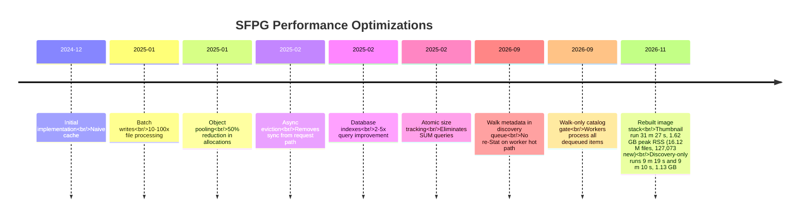

### 12.5 PRAGMA Optimize Strategy

SQLite `PRAGMA optimize` triggers the query planner to update `sqlite_stat1` statistics
for better index selection. In SFPG, **pool-aware** optimize is handled by
[`internal/dbconnpool/pragma.go`](../../internal/dbconnpool/pragma.go) — the
runner lives in the connection-pool package (never in `database`) and operates
on a single `*sql.Conn`.

| Scenario          | Mask                         | When                                                                  |
| ----------------- | ---------------------------- | --------------------------------------------------------------------- |
| Startup           | `0x10002` (fresh connection) | Async after listen + quiet; once per process                          |
| Periodic          | `0` (plain)                  | Every `DBOptimizeInterval` (default 1h) via `Writer.optimize`         |
| Migration         | `0` (plain)                  | Sync, only when migration actually applied                            |
| Startup discovery | `0` (plain)                  | Scheduled non-blocking after startup discovery completes successfully |
| Shutdown          | `0` (plain)                  | After batcher close, before pool close; 30s timeout                   |

- **SQLite 3.53.2**: `PRAGMA optimize` auto-limits analysis scope; do **not** add
  manual `PRAGMA analysis_limit`.
- **Stats target**: `sqlite_stat1` table; not per pooled connection.
- **Periodic timing**: `Writer.maintain`, the batcher's after-commit hook, calls
  `Writer.optimize`, which runs when `DBOptimizeInterval` has passed since
  `Writer.lastOptimize`, the time of the last successful run.

### 12.6 Benchmarks

**Cache Middleware (with async eviction):**

```
BenchmarkCacheMiddleware_CacheHit-8          5000000    250 ns/op
BenchmarkCacheMiddleware_CacheMiss-8          1000000   1250 ns/op
```

**File Processing (with batching):**

```
BenchmarkFileProcessing_100Files_Batched-8    100       10000000 ns/op  (100ms)
BenchmarkFileProcessing_100Files_Individual-8  10        100000000 ns/op (1000ms)
```

---

## 13. Testing Strategy

### 13.1 Test Organization

The test suite uses **build tags** to separate unit tests from integration tests:

- **Unit Tests**: Default tests (no build tag), fast, no external dependencies
- **Integration Tests**: Files ending in `_integration_test.go` with `//go:build integration` tag
- **E2E Web Tests**: Package `web-testsuite/` with `//go:build e2eweb` tag (HTTP-level tests against a running server)
- **Benchmarks**: Performance tests (run with `-bench` flag)

```
internal/
├── cachelite/
│   ├── cache_unit_test.go                     # Unit tests (default)
│   ├── http_cache_middleware_test.go          # Unit tests (default)
│   ├── http_cache_middleware_db_test.go       # DB-component tests (default)
│   ├── cache_benchmark_test.go                # Benchmarks (default)
│   └── cache_benchmark_integration_test.go    # Benchmarks (integration && benchmark; not plain -tags integration)
├── server/
│   ├── helpers_test.go                        # CreateApp, shared test options
│   ├── server_test.go                         # Unit tests (default)
│   ├── app_test.go                            # App + handler manager unit tests
│   ├── app_lifecycle_unit_test.go             # App lifecycle unit tests
│   ├── app_lifecycle_integration_test.go      # Run/Serve/restart integration
│   ├── app_maintenance_test.go                # Maintenance task unit tests
│   ├── server_integration_test.go             # Router/middleware integration
│   ├── config_lifecycle_integration_test.go   # Config DB lifecycle integration
│   ├── config_precedence_integration_test.go  # Precedence integration/e2e
│   ├── logging_integration_test.go            # Logging integration/e2e
│   ├── cache_batch_load_integration_test.go   # Cache batch load integration
│   ├── folder_index_sql_guard_test.go         # Folder index SQL guard tests
│   ├── trigger_discovery_integration_test.go  # TriggerDiscovery integration (real discovery run)
│   ├── infrastructure_service_test.go         # InfrastructureService unit
│   ├── infrastructure_service_db_test.go      # DB-component tests (default)
│   ├── infrastructure_pragma_test.go          # PRAGMA optimize scheduling
│   ├── infrastructure_cache_calibration_test.go
│   ├── runtime_manager_test.go                # RuntimeManager unit
│   ├── runtime_manager_integration_test.go
│   ├── subsystem_manager_test.go
│   ├── subsystem_manager_integration_test.go
│   ├── metrics_adapters_test.go
│   ├── quiet_once_test.go                     # Quiet-once logging helper tests
│   ├── helpers_integration_test.go            # Shared auth helpers
│   ├── database/
│   │   ├── writer_test.go                     # Writer on a new database (default)
│   │   ├── flush_test.go                      # Batch flush (default)
│   │   ├── folder_index_test.go               # Folder-index rebuild (default)
│   │   └── catalog_test.go                    # Discovery catalog (default)
│   └── files/
│       ├── service_test.go                    # Unit tests (default)
│       └── processor_test.go                  # Unit tests (default)
├── discovery/
│   ├── service_test.go                        # Service unit tests (default)
│   ├── walk_test.go                           # Walk and modification decision (default)
│   └── service_integration_test.go            # Real run (integration)
├── metadata/
│   ├── info_test.go                           # Unit tests (default)
│   └── extractor_integration_test.go          # ExifTool (integration)
├── memlimit/
│   └── memlimit_test.go                       # Unit tests (default)
└── workerpool/
    ├── workerpool_test.go                     # Unit tests
    ├── mock_test.go                           # Test doubles
    └── mock_helper_test.go                    # Test doubles
```

The layout above is a subset of the test files (not a full inventory).

**Running tests:**

```bash
# Unit tests only (fast, default)
go test ./...

# Integration tests only
go test -tags integration ./...

# All tests (unit + integration)
go test -tags integration ./...

# Specific integration test file
go test -tags integration ./internal/server -run TestConfigIntegration
```

### 13.2 Test Coverage

| Package          | Coverage | Type               | Notes                             |
| ---------------- | -------- | ------------------ | --------------------------------- |
| **cachelite**    | 85%+     | Unit + Integration | Unified batcher + eviction tested |
| **workerpool**   | 90%+     | Unit               | Pool dynamics and scaling         |
| **scheduler**    | 85%+     | Unit               | Task scheduling and cancellation  |
| **dbconnpool**   | 80%+     | Integration        | Connection pool behavior          |
| **server**       | 75%+     | Integration        | Unified batcher workflows         |
| **writebatcher** | 95%+     | Unit               | Batching and flush logic          |
| **files**        | 80%+     | Unit + Integration | File processing pipeline          |

### 13.3 Test Categories

1. **Unit Tests**: Test individual functions/packages (default, fast)
2. **Integration Tests**: Test package interactions (requires `-tags integration`)
3. **End-to-End Tests**: Test complete workflows (subset of integration)
4. **Benchmarks**: Measure performance

### 13.4 Test Location Conventions

Where each test category lives and how to choose the right seam.

#### 13.4.1 Unit Tests

- Live in `*_test.go` files in the same package as the code under test.
- Run with `go test ./...` (no build tag).
- Should be fast and isolated; prefer fakes and mocks over real databases or full server startup.

#### 13.4.2 Integration Tests

- Live in `*_integration_test.go` files guarded by `//go:build integration`.
- Run with `go test -tags integration ./...`.
- May use real SQLite databases, cross-package wiring, or the full HTTP router.

#### 13.4.3 E2E Web Tests

- Live in `web-testsuite/*_test.go` guarded by `//go:build e2eweb`.
- Run with `go test -tags e2eweb ./web-testsuite/...` or as part of `make test-all` (`-tags "integration e2eweb"`).
- Exercise the running application over HTTP (auth, gallery, config modal, lightbox, etc.).

#### 13.4.4 E2E / Browser Tests

- Live in `tests/*.spec.ts` as Playwright specifications.
- Exercise the running application through a real browser.
- Shared helpers: `tests/helpers.ts`, `tests/global-setup.ts`.

#### 13.4.5 Choosing a Test Seam

| Seam                                   | Location                                                                                                                                   | Cost     | Use When                                                                                                                                                                                                                                                                                |
| -------------------------------------- | ------------------------------------------------------------------------------------------------------------------------------------------ | -------- | --------------------------------------------------------------------------------------------------------------------------------------------------------------------------------------------------------------------------------------------------------------------------------------- |
| `mockConfigOps`                        | `internal/server/handlers/helpers_test.go`                                                                                                 | Very low | Unit-testing config/theme handlers that only need `interfaces.ConfigOps` / `func() *config.Config`.                                                                                                                                                                                     |
| `mockGalleryOps`                       | `internal/server/handlers/helpers_test.go`                                                                                                 | Very low | Unit-testing gallery/image/info-box handlers that only need `interfaces.GalleryOps`.                                                                                                                                                                                                    |
| `mockServerControl`                    | `internal/server/handlers/helpers_test.go`                                                                                                 | Very low | Unit-testing server/dashboard handlers that only need `interfaces.ServerControl`.                                                                                                                                                                                                       |
| `mockTemplateHelpers`                  | `internal/server/handlers/helpers_test.go`                                                                                                 | Very low | Unit-testing handlers that need `AddCommonTemplateData` and `ServerError` helpers.                                                                                                                                                                                                      |
| `fakeCredentialStore`                  | `internal/server/handlers/helpers_test.go`                                                                                                 | Very low | Unit-testing auth handlers that only need `interfaces.CredentialStore`.                                                                                                                                                                                                                 |
| `setupTestConfigHandlers`              | `internal/server/handlers/config_etag_test.go`                                                                                             | Low      | Unit-testing config handlers with mocked `config.ConfigService` and `auth.AuthService`.                                                                                                                                                                                                 |
| `setupTestDB` / `setupTestDBForConfig` | `internal/server/config/config_test.go`, `internal/server/config_helpers_test.go`, etc.                                                    | Medium   | Testing config/database logic that needs a real migrated SQLite database (in-memory or temp file).                                                                                                                                                                                      |
| `TestMain` + `TestUseMemDB`            | `internal/server/config/testdb_test.go` (pattern for package DB tests)                                                                     | Medium   | Shared memory-mode RW/RO pools: `TestUseMemDB: true` + empty DSN to `NewDbSQLConnPool`. A non-empty DSN selects file-backed mode even when the flag is true. Isolated file pools copy both images with `CopyMainTestDatabaseTo` / `CopyThumbsTestDatabaseTo` before opening a file DSN. |
| `testdb`                               | `internal/testdb` (`MemoryDatabases`, `NewMemoryDatabases`, `MainURI`, `ThumbsURI`, `Close`)                                               | Low      | Single memory-backed test database mechanism keyed by caller-supplied schema key; process-local seeds restored into named `memdb` VFS images. Used by `dbconnpool` slots and `gallerydb` shared/isolated harnesses (`config`, `cachelite`, … receive URIs only). Not for production.    |
| `dbconnpool` memory test helpers       | `internal/dbconnpool/schema_seed_helpers.go` (`CopyMainTestDatabaseTo`, `CopyThumbsTestDatabaseTo`; copy from a short-lived `testdb` pair) | Low      | File-backed test database copies for callers that already import `dbconnpool`. Do not open pools.                                                                                                                                                                                       |
| `fakeWriter`                           | `internal/discovery/helpers_test.go`                                                                                                       | Very low | Testing `discovery.Service` without a database: it records submitted files and holds the drain open while writes are pending.                                                                                                                                                           |
| `newTestWriter`                        | `internal/server/database/writer_test.go`                                                                                                  | Medium   | Testing `database.Writer`, batch flush, and the folder-index rebuild on a new migrated database in a temporary directory.                                                                                                                                                               |
| `*.testSeams.*`                        | `internal/server/testseams.go` + manager structs                                                                                           | Low–Med  | Stubbing App/manager lifecycle paths (serve, restart, pool recreate, handler build, cache hooks) without full `CreateApp` when a narrower seam suffices.                                                                                                                                |
| `CreateApp`                            | `internal/server/helpers_test.go`                                                                                                          | High     | Testing full routing, middleware, lifecycle, or anything that requires a wired `*server.App`. Use sparingly.                                                                                                                                                                            |

Prefer the lightest seam that exercises the behavior under test. `CreateApp` is appropriate when the test must verify interactions across handlers, middleware, sessions, the worker pool, or the database pools. For handler business logic in isolation, use the narrow per-group mocks (`mockConfigOps`, `mockGalleryOps`, `mockServerControl`, `mockTemplateHelpers`, `fakeCredentialStore`) or `setupTestConfigHandlers` instead. For App or manager lifecycle paths, prefer explicit `app.testSeams.*` or `app.<Manager>.testSeams.*` over embedding-promoted field names.

Integration tests that need custom `HandlerQueries` should set `app.InfrastructureService.testSeams.HandlerQueries` (not `app.testHookHandlerQueries`).

See also `AGENTS.md` for the project's testing workflow (for example, run `make test-all` once and grep the saved output rather than piping `go test` directly).

### 13.5 Running Tests

```bash
# Unit tests only (fast, default - recommended for TDD)
go test ./...

# Integration tests only
go test -tags integration ./...

# E2E web tests only
go test -tags e2eweb ./web-testsuite/...

# All tests (unit + integration + e2eweb) — same as make test-all
go test -tags "integration e2eweb" ./...

# Browser tests (Playwright; separate from go test)
make test-browser

# Specific package
go test ./internal/cachelite/...

# With coverage
go test -cover ./...
go test -tags "integration e2eweb" -cover ./...

# Run benchmarks
go test -bench=. ./internal/cachelite/...

# Race detection
go test -race ./...
go test -tags "integration e2eweb" -race ./...
```

### 13.6 Recent Testing Improvements (Feb 2026)

**Build Tag Separation:**

- Separated fast unit tests from slower integration tests
- Integration tests now require explicit `-tags integration` flag
- Faster CI/CD pipelines: unit tests run in <5s, integration in ~20s

**Concurrency Fixes:**

- Fixed race condition in cache write batch collection (data loss during shutdown)
- Added lock ordering documentation to prevent deadlocks
- Bounded `ParallelWalk` to a fixed worker pool and in-memory work handoff (no per-subdirectory goroutine spawn)
- Added context cancellation handling in multiple worker loops

**Test Quality:**

- Comprehensive table-driven tests (285 `t.Run()` across 45 files)
- Descriptive error messages with input/got/want context
- Proper cleanup with `t.Cleanup()` where appropriate
- See `references/tdd_process.md` and `references/methodology-html-content-test-writing.md` for testing methodology details

### 13.7 parallelwalkdir feeder (Sep 2026)

**Discovery walk topology (`internal/parallelwalkdir`):**

- Workers submit discovered subdirectories to an unbounded **schedule queue**; a **feeder** goroutine alone drains the schedule, calls `pending.Add(1)`, and sends to bounded **`dirCh`** so workers never block on a full `dirCh` while no goroutine is receiving.
- Production `dirCh` capacity remains `workers() × 1024`; `WithDirChCapacity` is for tests only (`WalkImageDir` does not set it).
- Documented in package godoc, `files.WalkImageDir` godoc, and the mermaid diagram under [parallelwalkdir (discovery directory walk)](#713-parallelwalkdir-discovery-directory-walk).

### 13.8 Recent Testing Improvements (Jul 2026)

**Phase 2 consolidation (WP-51 … WP-54, WP-16):**

- Reduced root `internal/server/*_test.go` files from 74 → **23**
- Root `CreateApp` mentions from 135 → **64**; 0 uncovered `internal/server/` functions (default + integration)

**Test seam extraction (WP-17, WP-18):**

- Removed all `testHook*` fields from `App` and embedded managers
- Centralized optional doubles in `internal/server/testseams.go` (`AppTestSeams`, `InfrastructureTestSeams`, `RuntimeManagerTestSeams`, `HandlerManagerTestSeams`)
- Tests use explicit `*.testSeams.*` accessors; no promoted `app.testHook*` assignments

---

## 14. Frontend Architecture

**Last Updated:** 2026-09-02

**Assets:** `web/templates/`, `web/static/` (not Go packages). Server render path: `ui` and `template` under `internal/server/`. See [Process-to-package map § UI assets](#26-ui-assets-not-go-packages).

SFPG uses a **hypermedia-driven, mobile-first** frontend built entirely with Go HTML templates, HTMX, Hyperscript, daisyUI, and TailwindCSS. There is no JavaScript framework and no client-side state management.

### 14.1 Design Principles

- **No JavaScript** — all interactivity via HTMX (HTML-over-the-wire) and Hyperscript
- **Mobile-first** — touch devices are first-class; desktop enhancements are additive
- **iOS safe areas** — `env(safe-area-inset-bottom)` used on body and modals to clear the home indicator
- **Responsive layout** — flexbox wrapping instead of fixed-grid for gallery tiles

### 14.2 Gallery Tile Layout

Gallery tiles use a `flex flex-wrap justify-center gap` container so tiles reflow naturally at all viewport widths without JavaScript. Each tile uses the daisyUI `card` component.

Thumbnail images use `object-contain` inside a `<figure>` element so portrait and landscape images display without cropping, regardless of aspect ratio.

Long filenames and directory names are truncated with **center-ellipsis** (preserving both prefix and suffix) rather than right-truncation, so the file extension and end of the name remain readable.

### 14.3 Lightbox Touch Navigation

The lightbox supports swipe navigation on touch devices via Hyperscript `pointerdown`/`pointerup` handlers:

- **Threshold:** 48px horizontal displacement required to trigger a swipe
- **Drift guard:** ±40px vertical tolerance prevents accidental swipes during vertical scrolling
- **Ghost tap prevention:** a `:didSwipe` flag suppresses the `click` event that fires after a swipe
- **Button visibility:** prev/next nav buttons are hidden on mobile (`hidden sm:flex`); swipe replaces them
- **Modal height:** uses `100dvh` (dynamic viewport height) with `env(safe-area-inset-bottom)` subtracted for correct iOS Safari rendering

### 14.4 Mobile Info Panel

On touch devices (detected via CSS `hover:none` and `pointer:coarse` media queries), the desktop sidebar info box is hidden entirely and replaced with a dedicated modal:

| Element              | Desktop                  | Mobile                 |
| -------------------- | ------------------------ | ---------------------- |
| `#box_info_wrapper`  | Visible sidebar (toggle) | `display:none` via CSS |
| `#info-btn`          | Visible (`sm:flex`)      | Hidden (`hidden`)      |
| `#info-btn-mobile`   | Hidden (`sm:hidden`)     | Visible (`flex`)       |
| `#mobile_info_modal` | —                        | daisyUI checkbox modal |

Content is mirrored from `#box_info` into `#box_info_mobile` on every HTMX swap via a Hyperscript `on htmx:afterSwap` handler, so the modal always reflects the latest selection without an extra network request.

The dashboard suppresses the sidebar entirely — `#box_info_wrapper` is hidden via Hyperscript `init` when `#dashboard-container` is detected in the DOM.

### 14.5 Dashboard Typography

The dashboard uses a compact typography scale optimised for dense metric display:

| Element          | Before                 | After                        |
| ---------------- | ---------------------- | ---------------------------- |
| Page heading     | `text-3xl font-bold`   | `text-2xl font-semibold`     |
| Section headings | `text-lg`              | `text-base`                  |
| Card titles      | `card-title text-base` | plain `h3 text-sm`           |
| Stat labels      | (no size)              | `text-xs`                    |
| Stat values      | `font-mono text-2xl`   | `font-semibold text-lg/base` |

Removing `font-mono` from stat values aligns them with the rest of the UI's sans-serif type while `font-semibold` maintains visual weight.

### 14.6 Template Files

| Template                     | Purpose                                                                     |
| ---------------------------- | --------------------------------------------------------------------------- |
| `layout.html.tmpl`           | Shell, footer toolbar, mobile info modal, lightbox modal, safe-area padding |
| `gallery.html.tmpl`          | Flex tile grid, HTMX gallery content, mobile info sync                      |
| `lightbox-content.html.tmpl` | Lightbox image, swipe handlers, prev/next buttons                           |
| `infobox-image.html.tmpl`    | Image metadata panel (loaded into `#box_info`)                              |
| `infobox-folder.html.tmpl`   | Folder metadata panel (loaded into `#box_info`)                             |
| `dashboard.html.tmpl`        | Admin metrics dashboard                                                     |

---

## 15. Appendix

### 15.1 File Structure

```
sfpg-go/
├── cmd/
│   ├── sfpg-go-dashboard/       # TUI dashboard entry point
│   └── (main package at root)   # Main application entry point (root main.go)
├── docs/
│   ├── diagrams/                # Architecture diagrams
│   ├── ARCHITECTURE.md          # This file
│   └── SERVER_DEEP_DIVE.md      # Server package entry point
├── internal/
│   ├── cachelite/               # HTTP response caching
│   ├── tableswap/               # Atomic SQLite table rotation
│   ├── rssmonitor/              # Optional Linux process RSS monitor
│   ├── sqlite3stat/             # SQLite connection memory-status helpers
│   ├── workerpool/              # Concurrent task processing
│   ├── scheduler/               # Task scheduling
│   ├── queue/                   # Generic deque
│   ├── writebatcher/            # Batch database operations (with overflow)
│   ├── dque/                    # Persistent on-disk FIFO (Writer overflow + discovery backlog)
│   ├── flock/                   # Cross-platform file locking
│   ├── errors/                  # Error sentinels for dque
│   ├── dbconnpool/              # Connection pooling
│   ├── testdb/                  # Memory-backed test databases (process-local seeds)
│   ├── gallerydb/               # Database queries (sqlc)
│   ├── gallerylib/              # File import / path-chain upserts
│   ├── thumbnail/               # Thumbnail, MD5, and pHash generation
│   ├── discovery/               # Discovery Service: walk, backlog, workers, run counters
│   ├── metadata/                # EXIF, IPTC, and XMP extraction with ExifTool
│   ├── memlimit/                # Process memory limit and worker count
│   ├── osza/                    # Zero-alloc os helpers (facade + readdir/, README.md)
│   ├── parallelwalkdir/         # Bounded dir walk: schedule queue + feeder → dirCh (GOMAXPROCS workers)
│   ├── gensyncpool/             # Reset-enforcing sync.Pool wrappers
│   ├── getopt/                  # Config from flags/env
│   ├── multihandler/            # Multi-handler structured logging
│   ├── profiler/                # Optional CPU/mem/block profiling
│   ├── coords/                  # Geographic coordinate parsing
│   ├── humanize/                # Human-readable formatting
│   ├── log/                     # Structured logging wrappers
│   ├── testutil/                # Shared test helpers
│   ├── gen-test-files/          # Synthetic test file generation
│   ├── server/                  # Web server
│   │   ├── app.go, server.go, router.go
│   │   ├── infrastructure_service.go, runtime_manager.go, handler_manager.go, subsystem_manager.go
│   │   ├── testseams.go         # App/manager test doubles
│   │   ├── auth/                # Authentication service
│   │   ├── cachebatch/          # Cache batch-load coordination
│   │   ├── cachepreload/        # Cache preload manager
│   │   ├── conditional/         # ETag/304 helper package
│   │   ├── config/              # Configuration management
│   │   ├── database/            # Database setup, pools, and the write path (Writer)
│   │   ├── files/               # File processing (metadata, thumbnail, hashes)
│   │   ├── handlers/            # Route handlers (auth, gallery, config, menu, theme, etc.)
│   │   ├── handlerqueriesfake/  # Shared HandlerQueries fake for tests
│   │   ├── interfaces/          # Handler dependency interfaces
│   │   ├── logging/             # Logging helpers
│   │   ├── metrics/             # Runtime metrics
│   │   ├── middleware/          # HTTP middleware (auth, conditional, logging, loopback)
│   │   ├── modulestate/         # Module active-state tracking
│   │   ├── pathutil/            # Path utilities
│   │   ├── security/            # Lockout calculations and IP rate limiting
│   │   ├── session/             # Session management
│   │   ├── template/            # Shared template data
│   │   ├── ui/                  # Template rendering
│   │   └── validation/          # Validation helpers
│   └── ...
├── migrations/                  # Database migrations
│   ├── migrations/              # Main database migrations
│   └── thumbs/                  # Thumbnails database migrations
├── sqlc/                        # SQL query definitions
├── web/                         # HTML templates and static assets
└── scripts/                     # Utility scripts
```

### 15.2 External Dependencies

| Dependency                               | Purpose                                                                                         | License                                                       |
| ---------------------------------------- | ----------------------------------------------------------------------------------------------- | ------------------------------------------------------------- |
| **github.com/charmbracelet/bubbles**     | TUI dashboard components                                                                        | MIT                                                           |
| **github.com/charmbracelet/bubbletea**   | TUI framework                                                                                   | MIT                                                           |
| **github.com/charmbracelet/lipgloss**    | TUI styling                                                                                     | MIT                                                           |
| **github.com/dop251/goja**               | JavaScript runtime (tests)                                                                      | BSD-2-Clause                                                  |
| **github.com/golang-migrate/migrate/v4** | Database migrations                                                                             | MIT                                                           |
| **github.com/gorilla/sessions**          | Session management                                                                              | BSD-3-Clause                                                  |
| **github.com/klauspost/compress**        | zstd codec for HTTP cache bodies                                                                | BSD-3-Clause (Apache-2.0 for `gzhttp`)                        |
| **github.com/lbe/go-exiftool-wasm**      | ExifTool (with Perl) compiled to WebAssembly: EXIF, IPTC, XMP extraction                        | MIT                                                           |
| **github.com/lbe/go-image-phash**        | Perceptual hash (pHash) of decoded pixels                                                       | MIT                                                           |
| **github.com/lbe/wuffs-wasm**            | PNG and GIF decode (Wuffs compiled to WebAssembly)                                              | MIT                                                           |
| **github.com/m8rge/go-scaled-jpeg**      | Scaled JPEG decode (thumbnail generation)                                                       | MIT; BSD-3-Clause (code derived from Go); IJG (IDCT routines) |
| **github.com/ncruces/go-exiftool**       | Native ExifTool server (`exiftool -stay_open`); replaced by the github.com/lbe/go-exiftool fork | MIT                                                           |
| **github.com/ncruces/go-sqlite3**        | SQLite driver                                                                                   | MIT                                                           |
| **github.com/phsym/console-slog**        | Console slog handler                                                                            | MIT                                                           |
| **github.com/pkg/profile**               | CPU/mem/block profiling                                                                         | BSD-2-Clause                                                  |
| **golang.org/x/crypto**                  | bcrypt password hashing                                                                         | BSD-3-Clause                                                  |
| **golang.org/x/image**                   | WebP decode, thumbnail resize (`draw`)                                                          | BSD-3-Clause                                                  |
| **golang.org/x/net**                     | Networking utilities                                                                            | BSD-3-Clause                                                  |
| **golang.org/x/sync**                    | `errgroup` concurrency primitives                                                               | BSD-3-Clause                                                  |
| **golang.org/x/sys**                     | OS-specific syscalls (RAM size, directory reads)                                                | BSD-3-Clause                                                  |
| **gopkg.in/yaml.v3**                     | YAML config parsing                                                                             | MIT                                                           |

The binary also embeds ExifTool and a Perl interpreter compiled to WebAssembly by zeroperl (ExifTool and Perl: Artistic License or GPL-1.0-or-later; zeroperl: MIT), through `go-exiftool-wasm`, and the Wuffs decoders compiled to WebAssembly (Apache-2.0 or MIT, used under MIT), through `wuffs-wasm`. See [THIRD_PARTY_NOTICES.md](../THIRD_PARTY_NOTICES.md).

---

## 16. Related Documentation

- [Development Setup](../../README.md#development)
- [Deployment Guide](../../DEPLOYMENT.md)
- [Configuration Reference](../../ENV_CONFIGURATION.md)
- [Architecture Diagrams](diagrams/)
- [osza — zero-allocation os helpers](../internal/osza/README.md)

---

**Document Version:** 1.4
**Last Updated:** 2026-09-24
**Maintained By:** @whgi
